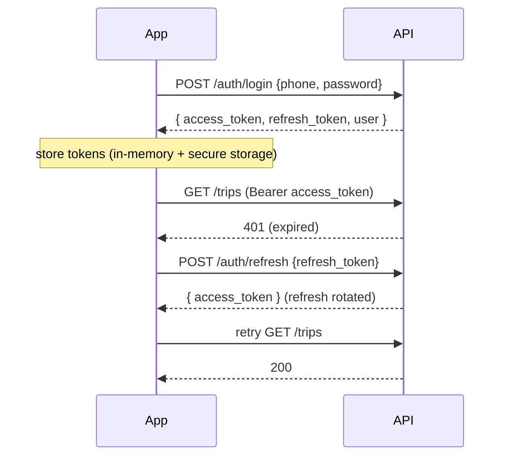
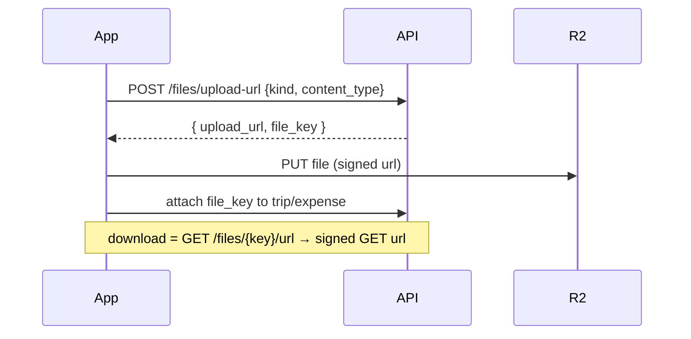

# API Integration Guide & Error Code Catalog
## Fleet Management System

| Field | Value |
|---|---|
| Version | 1.0 (Draft) |
| Date | 2026-10-10 |
| Status | Draft — ready for review |
| Related | docs/data_model_and_api_contracts.md, docs/configuration_and_environments.md, docs/validation_and_formats.md |

> How the three frontends talk to the API consistently, and the canonical list of
> error codes so every app handles failures the same way.

---

## 1. Base URL & versioning
- Base URL comes from the app's `environment.ts` (`apiBaseUrl`), e.g.
  `http://localhost:8000/api/v1`.
- All endpoints are versioned under `/api/v1` (see data model & API contracts doc).

## 2. Request conventions
| Topic | Rule |
|---|---|
| Format | JSON in/out; `Content-Type: application/json`. |
| Auth header | `Authorization: Bearer <access_token>` on every protected call. |
| Tenant | Never sent by the client — derived from the token server-side. |
| Pagination | `?page=1&page_size=20` → `{ items, page, page_size, total }`. |
| Filtering/sorting | Query params per resource (e.g. `?status=submitted&sort=-trip_date`). |
| Dates | Send ISO-8601 UTC; display converts to IST (see validation doc). |

## 3. Auth & token lifecycle (frontend)



**HTTP interceptor (all apps):**
1. Attach `Authorization` header from stored access token.
2. On `401`, call `/auth/refresh` once, update token, retry the original request.
3. If refresh fails → clear tokens, redirect to `/login`.
4. Map error responses to typed errors for the UI (see §6).

**Token storage:** access token in memory; refresh token in secure storage
(Ionic Secure Storage on mobile). Never store Aadhaar or other PII locally.

## 4. File upload / download flow

- Validate content-type and size before requesting the URL.
- Show the vehicle-running loader during upload.

## 5. Pagination handling (frontend)
- Lists request `page`/`page_size`; render `items`, show total, enable next/prev
  (web: AG Grid paging / `mat-paginator`; mobile: paged list or infinite scroll).
- Never fetch an entire table at once.

---

## 6. Error Response Shape (canonical)
Every error returns this shape:
```json
{
  "error": {
    "code": "STRING_CODE",
    "message": "Human-readable summary.",
    "details": [ { "field": "phone", "message": "..." } ]
  }
}
```
`details` is present only for validation errors.

## 7. Error Code Catalog

| HTTP | `code` | When | Frontend handling |
|---|---|---|---|
| 400 | `BAD_REQUEST` | Malformed request | Generic error toast |
| 401 | `UNAUTHENTICATED` | Missing/invalid/expired token | Trigger refresh; else go to login |
| 401 | `INVALID_CREDENTIALS` | Wrong phone/password on login | Inline "Invalid phone or password" |
| 403 | `FORBIDDEN_ROLE` | Role not allowed for endpoint | "You don't have access" |
| 403 | `FORBIDDEN_TENANT` | Cross-tenant access attempt | Treat as not found |
| 403 | `FORBIDDEN_OWNERSHIP` | User accessing another user's trip | "You don't have access" |
| 404 | `NOT_FOUND` | Resource missing (or hidden cross-tenant) | "Not found" |
| 409 | `DUPLICATE_PHONE` | Phone already used in company | Inline on phone field |
| 409 | `DUPLICATE_VEHICLE_NUMBER` | Vehicle number already used | Inline on vehicle field |
| 409 | `INVALID_STATE_TRANSITION` | e.g. approve a non-submitted trip | Toast "Action not allowed in current state" |
| 422 | `VALIDATION_ERROR` | Field validation failed | Inline per-field from `details` |
| 500 | `INTERNAL_ERROR` | Unexpected server error | Generic "Something went wrong" (no details) |

> Backend never returns stack traces or raw exceptions. Errors are logged
> server-side with request/tenant/user id for debugging.

## 8. Example calls

**Create a trip**
```
POST /api/v1/trips
Authorization: Bearer <token>
{ "driver_id": 1, "vehicle_id": 2, "location": "Chennai–Bangalore",
  "trip_date": "2026-10-09", "start_km": 1000, "end_km": 1250 }
→ 201 { "id": 10, "status": "draft", "total_km": 250, "total_expense": 0.00, ... }
```

**Approve a trip (wrong state)**
```
POST /api/v1/trips/10/approve
→ 409 { "error": { "code": "INVALID_STATE_TRANSITION",
        "message": "Only submitted trips can be approved." } }
```

**Validation failure**
```
POST /api/v1/users  { "phone": "123" , ... }
→ 422 { "error": { "code": "VALIDATION_ERROR", "message": "One or more fields are invalid.",
        "details": [ { "field": "phone", "message": "Enter a valid 10-digit mobile number." } ] } }
```

---

## 9. Frontend integration checklist (per feature)
- [ ] Use the shared API client + `ENDPOINTS` (no hard-coded URLs).
- [ ] Attach auth via the interceptor (don't set headers manually).
- [ ] Handle loading / empty / error / success states (see UI design system).
- [ ] Map error `code` to the right UX (table §7).
- [ ] Paginate lists; never load everything.
- [ ] Convert dates to IST for display; send UTC.

