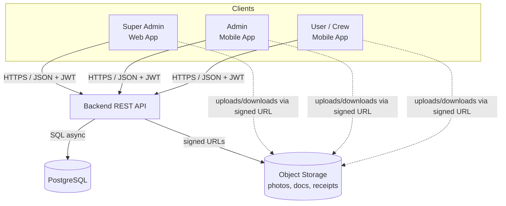
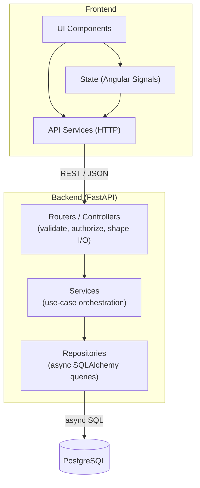
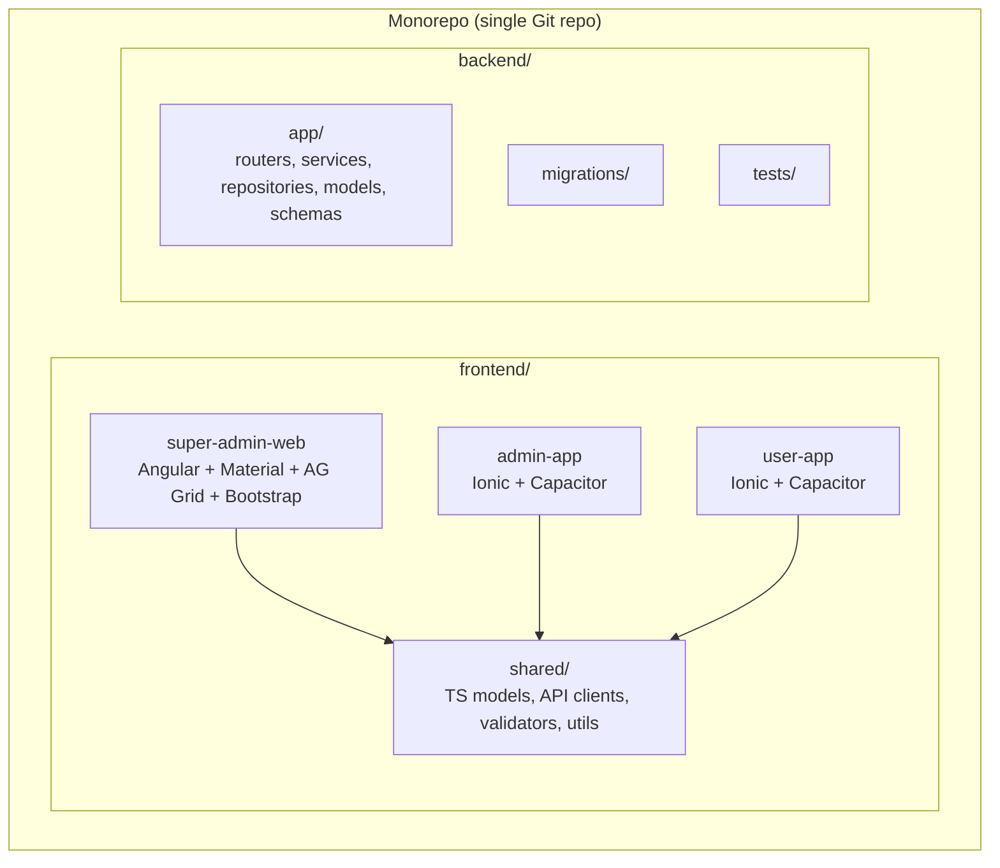
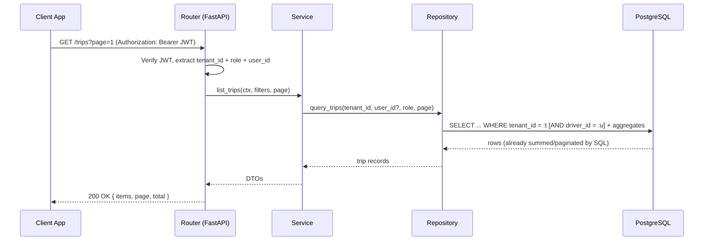
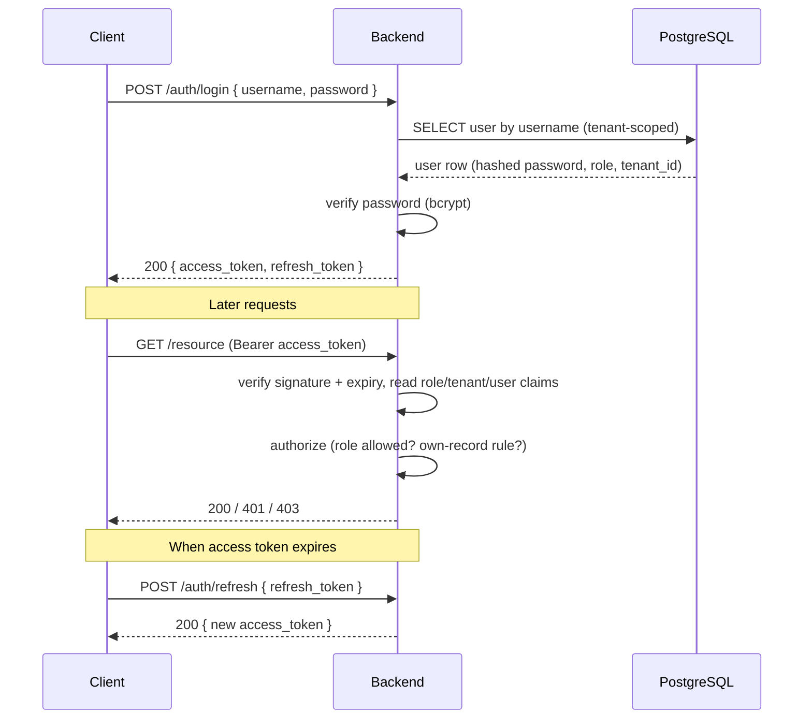
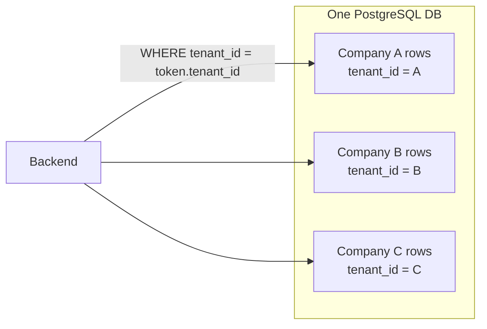
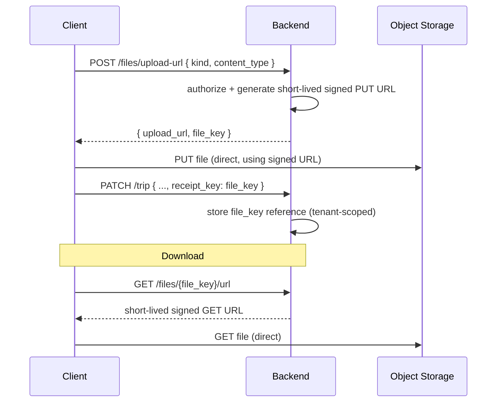
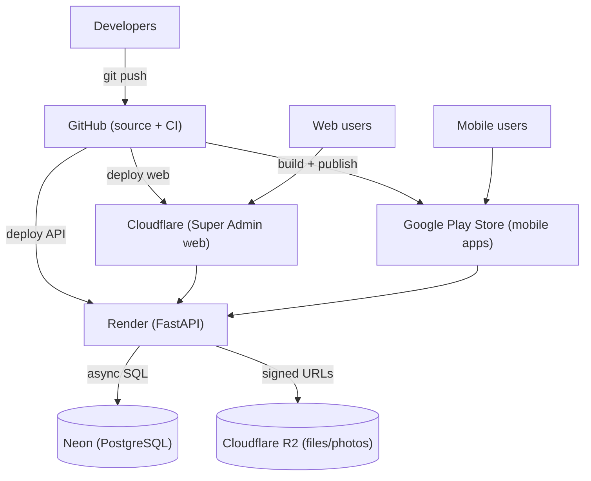
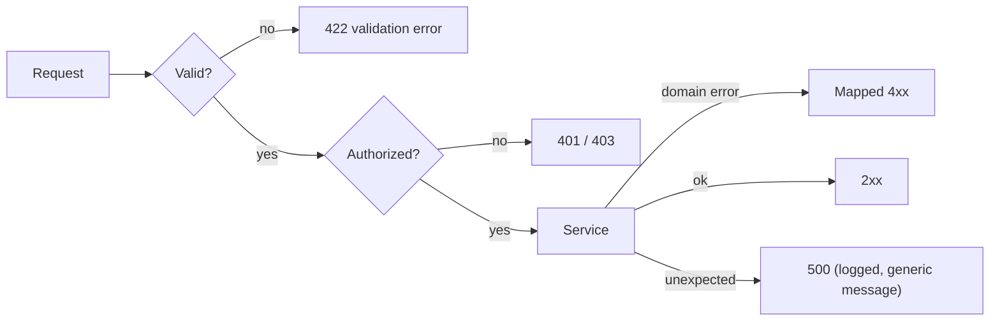
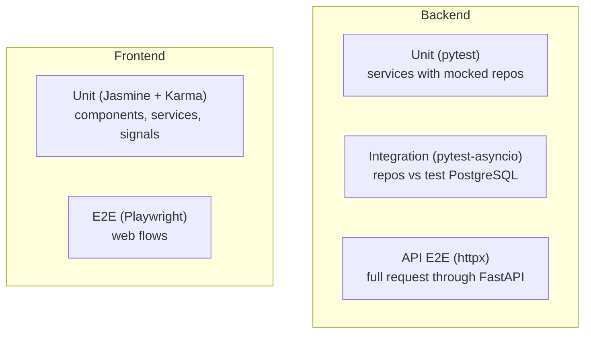

# Architecture Specification
## Fleet Management System

| Field | Value |
|---|---|
| Document Title | Fleet Management System — Architecture Specification |
| Version | 1.0 (Draft — complete) |
| Date | 2026-10-09 |
| Status | Draft — ready for review |
| Related | docs/business_requirement.md |

---

## 1. Introduction & Purpose

This document describes the technical architecture of the **Fleet Management System**, a multi-tenant product that lets private transport companies replace their paper logbooks with digital apps. It defines the system's components, how they communicate, the technology stack, data flow, authentication, deployment, and the testing strategy.

The architecture derives from the business requirements in [business_requirement.md](business_requirement.md). It intentionally stays as simple as possible: few moving parts, minimal external dependencies, and most calculation pushed into the database so the application servers stay thin.

**Audience:** developers, validators, and future maintainers.

## 2. Architecture Goals & Principles

| # | Principle | What it means in practice |
|---|---|---|
| 1 | Simple over clever | Fewest moving parts that satisfy the requirement. No speculative abstraction. |
| 2 | Thin servers | Business calculation (totals, aggregations, KM, costs) is done in the database via SQL, not in Python loops. The API orchestrates; the DB computes. |
| 3 | Lightweight frontends | Apps fetch and render; heavy data work stays server/DB-side. Pagination and server-side filtering by default. |
| 4 | Single source of DB access | Only the FastAPI backend connects to PostgreSQL. No frontend touches the database directly. |
| 5 | Stateless API | The backend holds no session state; auth is carried in JWTs. This keeps horizontal scaling and cloud deployment easy. |
| 6 | Tenant isolation | Every row is scoped to a company (tenant); every query filters by tenant, enforced server-side. |
| 7 | Secure by default | Server-side authorization on every endpoint, input validated at the boundary, least privilege per role. |
| 8 | Testable by design | Business logic lives in services/repositories (not controllers/components) behind injectable seams so it can be unit-tested to the 80% coverage gate. |
| 9 | Minimal external deps | No Docker for local runs; prefer managed free-tier cloud services for deployment only. |

## 3. System Context (High-Level)

Three client applications talk to one REST API, which is the only component that reaches the database and object storage.



**Key points**
- All three clients use the same REST API and the same auth scheme (JWT).
- The API is the sole gateway to PostgreSQL.
- Large binaries (RC card, license, receipts) are not streamed through the API; the API issues short-lived signed URLs and clients upload/download directly from object storage, keeping the server light.

## 4. Logical Architecture (Components & Layers)

The backend uses a classic layered structure so logic stays out of the HTTP layer and remains unit-testable.



**Layer responsibilities**

| Layer | Responsibility | Keeps out |
|---|---|---|
| Routers/Controllers | Parse requests, enforce auth + role, validate via Pydantic, return HTTP status and response | Business logic, raw SQL |
| Services | Orchestrate a use case, apply rules that cannot be expressed in SQL, manage transactions | HTTP concerns, ORM session wiring details |
| Repositories | All data access via async SQLAlchemy; aggregation/calculation pushed into SQL | Request/response models |
| DB (PostgreSQL) | Stores data and performs the heavy calculation (sums, totals, KM, cost rollups) via queries/views. | - |

**Frontend responsibilities**

| Piece | Responsibility |
|---|---|
| UI Components | Render data, capture input; no business rules. |
| API Services | Typed HTTP calls (RxJS); map backend DTOs to view models. |
| State (Signals) | Hold view state reactively; no NgRx or other state library. |

## 5. Module / Folder Structure

The product is a set of separate apps that share **models and logic**, never UI components (Angular Material and Ionic UI kits must not be mixed).



**Backend folder sketch**

```
backend/
  app/
    main.py          # FastAPI app factory
    core/            # config, security (JWT), db session, deps
    routers/         # one module per feature (trips, users, vehicles, ...)
    services/        # use-case logic (testable, no HTTP)
    repositories/    # async SQLAlchemy data access + SQL aggregation
    models/          # SQLAlchemy ORM models
    schemas/         # Pydantic v2 request/response DTOs
  migrations/        # migration scripts (tool TBD — see §16)
  tests/             # pytest (unit + integration + API E2E via httpx)
```

**Shared boundary rule:** `frontend/shared/` holds TypeScript interfaces, API client functions, and validation/formatting helpers only. UI components are **not** shared — the web app uses Angular Material/AG Grid/Bootstrap; the two mobile apps use Ionic components only.

## 6. Technology Stack

> Versions reflect the approved stack. All libraries below are free/open-source unless noted.

**Frontend — Super Admin Web App**

| Concern | Choice | Notes |
|---|---|---|
| Framework | Angular 20 | Standalone components, Signals for state. |
| UI kit | Angular Material + CDK | Web app only. |
| Data grid | AG Grid Community | Free (MIT) edition only; no enterprise features. |
| Styling | Bootstrap 5 + SCSS | Layout/utilities + custom theming. |
| Async | RxJS | HTTP and stream composition. |

**Frontend — Admin & User Mobile Apps**

| Concern | Choice | Notes |
|---|---|---|
| Framework | Angular 20 + Ionic 8 | Ionic components only. |
| Native shell | Capacitor 7 | Packaging for Android (Play Store). |
| State | Angular Signals | No NgRx. |
| Async | RxJS | - |

**Backend**

| Concern | Choice | Notes |
|---|---|---|
| Language | Python 3.13 | - |
| Framework | FastAPI | Async REST API. |
| Server | Uvicorn | ASGI server. |
| Validation | Pydantic v2 | Request/response DTOs. |
| ORM | Async SQLAlchemy 2.0 | Confirmed by stakeholder. |
| DB driver | asyncpg | Async PostgreSQL driver, supports Python 3.13. |
| Auth | PyJWT + passlib[bcrypt] | JWT issue/verify, password hashing. |
| Migrations | Alembic | Confirmed; version-controlled schema, pairs with SQLAlchemy. |

**Database & tooling**

| Concern | Choice |
|---|---|
| Database | PostgreSQL |
| Package/deps (BE) | uv |
| Lint/format (BE) | Ruff, mypy, pre-commit |
| Lint/format (FE) | ESLint + Prettier |
| Tests (FE) | Jasmine + Karma + karma-coverage, Playwright (E2E) |
| Tests (BE) | pytest + pytest-cov + pytest-asyncio, httpx (API E2E) |

**Local development:** No Docker. Apps run directly (`uvicorn`, `ng serve`, `ionic serve`) against a local or managed PostgreSQL instance.

## 7. Request & Data Flow

A typical read request (e.g. a user listing their trips):



**Notes**
- Filtering by `tenant_id` and (for the `user` role) `driver_id` happens in the query, not in Python.
- Totals (trip cost, KM) are computed in SQL via aggregates or views.
- Lists are paginated at the DB level; the API never loads a full table into memory.

## 8. Authentication & Authorization Flow

Stateless JWT-based auth. The backend issues a short-lived **access token** and a longer-lived **refresh token** on login.



**Token claims:** `sub` (user id), `tenant_id`, `role`, `exp`.

**Authorization rules (enforced server-side on every endpoint)**

| Rule | Mechanism |
|---|---|
| Role gate | FastAPI dependency checks the `role` claim against the endpoint's allowed roles. |
| Tenant isolation | Every query filters by the token's `tenant_id`. |
| Own-records (user role) | Trip list/update for `user` is filtered by `driver_id = sub`. |
| Password storage | bcrypt via passlib; plaintext never stored or logged. |

> The frontend hides unauthorized actions for UX, but the backend is the authoritative enforcement point.

## 9. Multi-Tenancy Strategy

The product serves multiple companies. The chosen approach is a **shared database with a `tenant_id` column** on every tenant-owned table (row-level isolation).



**Why row-level (not schema-per-tenant or DB-per-tenant)**

| Option | Verdict | Reason |
|---|---|---|
| Shared DB + `tenant_id` column | **Chosen** | Simplest, one migration path, fits medium scale (~100 vehicles/company), minimal ops. |
| Schema-per-tenant | Rejected for now | More operational overhead; unnecessary at this scale. |
| Database-per-tenant | Rejected for now | Heaviest to run and migrate; overkill. |

**Guardrails**
- `tenant_id` is taken from the JWT, never from the request body/query.
- A shared repository base applies the `tenant_id` filter so individual queries cannot forget it.
- Composite indexes lead with `tenant_id` (e.g. `(tenant_id, created_at)`).

## 10. Data Management & Persistence Approach

**Principle:** the database does the heavy lifting; the backend stays thin.

| Topic | Approach |
|---|---|
| Access | All data access through async SQLAlchemy repositories. No ORM calls in routers. |
| Calculation | Sums, counts, cost/KM rollups, and report figures computed in SQL (aggregates, `GROUP BY`, or database views) — not in Python loops. |
| Reads | Server-side pagination (`LIMIT`/`OFFSET` or keyset) and filtering; return only needed columns. |
| Writes | Wrapped in a transaction per use case in the service layer. |
| Reporting | Expense/profit figures from SQL views or aggregate queries, so the report endpoint is a thin pass-through. |
| Soft delete vs hard delete | Records are retained permanently (no auto-purge); where "delete" is a role action, prefer a soft-delete/`is_active` flag so history survives. |
| Integrity | Foreign keys, `NOT NULL`, `CHECK` (e.g. `end_km >= start_km`), and unique constraints enforced in the schema. |

**Example: trip totals computed in SQL (illustrative)**

```sql
SELECT t.id,
       (t.end_km - t.start_km)                    AS total_km,
       COALESCE(SUM(e.fuel + e.toll + e.parking
                    + e.permit_cost + e.other_cost), 0) AS total_expense
FROM trips t
LEFT JOIN trip_expenses e ON e.trip_id = t.id
WHERE t.tenant_id = :tenant_id
GROUP BY t.id;
```

**Testability note for the Validator:** repositories are the DB seam. Unit tests mock the repository to test service logic; integration tests run real queries against a test PostgreSQL schema with seeded fixtures to verify the SQL calculations.

## 11. File & Media Storage

Photos and documents (RC card, license, expense receipts) are stored in **object storage**, not in PostgreSQL and not streamed through the API.



| Rule | Reason |
|---|---|
| DB stores only the file key/reference | Keeps the database small and fast. |
| API issues short-lived signed URLs | Server stays light; no large payloads through the API. |
| File keys are tenant-prefixed | Prevents cross-tenant access. |
| No sensitive file cached in plain mobile storage | Security requirement from the BRD. |

## 12. Deployment Architecture

Local development uses no Docker. Production uses managed free-tier services.



| Component | Target | Notes |
|---|---|---|
| Super Admin web app | Cloudflare (Pages) | Static Angular build on CDN. |
| Mobile apps (Admin, User) | Google Play Store | Built with Capacitor. |
| Backend API | Render | Managed host for FastAPI; always-on Starter plan. |
| Database | Neon | Managed serverless PostgreSQL. |
| File/object storage | Cloudflare R2 | Photos, docs, receipts. |
| Source & CI | GitHub | Repo + build/deploy pipelines. |

**Config:** all environment-specific values (DB URL, JWT secret, R2 credentials) come from environment variables per deployment target — never committed to source.

## 13. Error Handling & Validation Conventions

| Concern | Convention |
|---|---|
| Input validation | Pydantic v2 schemas at the API boundary reject malformed input with `422`. |
| Business errors | Services raise typed domain errors mapped to HTTP codes by a central handler. |
| Error shape | Consistent JSON: `{ "error": { "code": "message", "details": {} } }`. |
| Status codes | `200/201` success, `400` bad request, `401` unauthenticated, `403` forbidden, `404` not found, `409` conflict, `422` validation, `500` unexpected. |
| No leakage | Internal exceptions/stack traces never returned to clients; logged server-side. |
| Frontend | API services surface typed errors; UI shows friendly messages and never trusts client-side checks for security. |



## 14. Testing Strategy

The build fails below **80% line and branch coverage**, so testability is designed in.



| Layer | Tooling | What it covers | What the Validator needs |
|---|---|---|---|
| BE unit | pytest + mocks | Service logic, authorization rules, error mapping | Mocked repositories, fake auth context |
| BE integration | pytest-asyncio + asyncpg | Real SQL, aggregates, tenant filtering, constraints | Test PostgreSQL schema, seed fixtures, per-test transaction rollback |
| BE API E2E | pytest + httpx | Endpoint contracts, status codes, role gates | Test DB + seeded tenant/users/tokens |
| FE unit | Jasmine + Karma + karma-coverage | Components, API services, signal state | Mocked HTTP client |
| FE E2E | Playwright | Key web user journeys (login, create trip, approve) | Running web app + stubbed/seeded API |

**Seams for mocking:** repositories (DB), the signed-URL/storage client, and the clock/ID generator are injectable so external boundaries can be faked.

## 15. Cross-Cutting Concerns (Security, Logging, Config)

| Concern | Approach |
|---|---|
| AuthN/AuthZ | JWT verified on every request; role + tenant + own-record checks server-side. |
| Secrets/config | Environment variables per deployment; nothing sensitive in source or mobile storage. |
| Transport security | HTTPS everywhere (managed by Cloudflare / host). |
| Logging | Structured logs with request id, tenant id, user id; no secrets or PII in logs. |
| Input hardening | Validation at boundary; parameterized queries via SQLAlchemy (no string-built SQL) prevents injection. |
| CORS | Backend allows only the known web app origin(s). |
| Rate limiting | Basic throttling on auth endpoints (host/platform level) to resist brute force. |
| Least privilege | DB credentials scoped to the app; roles restricted per endpoint. |

## 16. Open Decisions & Risks

**Open decisions (need confirmation before the Developer agent relies on them)**

| # | Decision | Options | Recommendation |
|---|---|---|---|
| - | None outstanding | - | All core decisions confirmed (see PROJECT-LOG.md). |

> **Resolved:** ORM = Async SQLAlchemy 2.0, Migrations = Alembic, Backend host = Render, Auth = JWT access (15 min) + refresh (7 day) — all confirmed and recorded in [PROJECT-LOG.md](PROJECT-LOG.md).

**Risks & trade-offs**

| Risk | Impact | Mitigation |
|---|---|---|
| "Calculation in DB only" can make complex rules hard to unit-test | Coverage/clarity | Keep rules that are hard to express in SQL in the service layer; use integration tests for SQL aggregates. |
| Row-level multi-tenancy relies on never forgetting the filter | Data leak across tenants | Centralized tenant filter in a repository base; tests assert cross-tenant isolation. |
| Free-tier hosts may cold-start / sleep | Latency for first request | Acceptable at this scale; revisit if it hurts UX. |
| Signed-URL uploads bypass the API | Harder to validate file content | Validate content-type and size on URL issuance; scan/limit as needed later. |

---

## Appendix: Implementation Order (for the Developer agent)
1. Database schema + migrations (tool per §16) and seed data.
2. Backend core: config, DB session, JWT security, base repository (tenant filter).
3. Auth endpoints (login/refresh) + role dependencies.
4. Feature modules backend-first: Users, Vehicles, Trips (+approval), Service, Trip Planner, Reports.
5. Shared frontend models + API clients.
6. Super Admin web app, then Admin and User mobile apps.
7. Tests alongside each layer to hold the 80% gate.