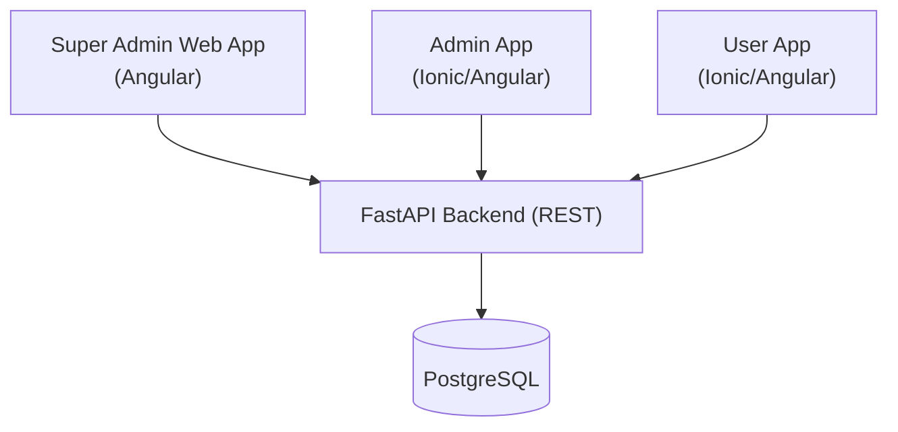
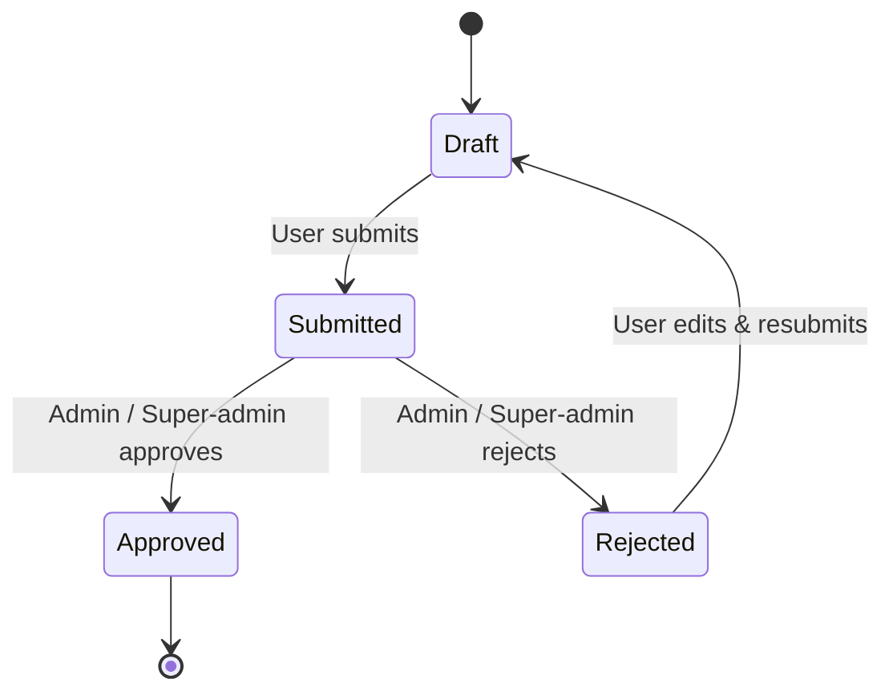
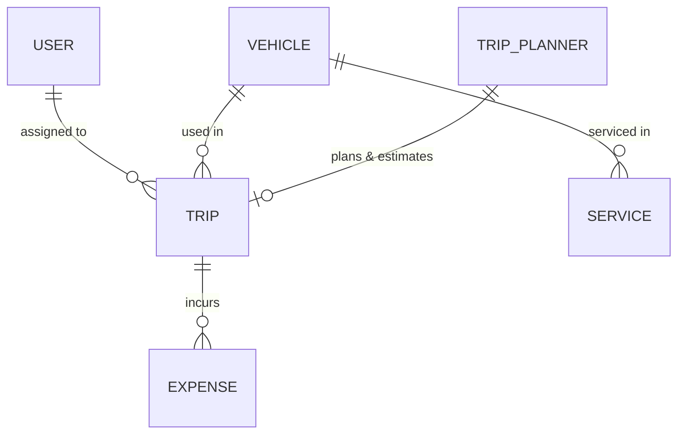

# Business Requirement Document (BRD)
## Fleet Management System

| Field | Value |
|---|---|
| Document Title | Fleet Management System – Business Requirement Document |
| Version | 1.0 (Draft) |
| Date | 2026-10-09 |
| Status | Draft – pending sign-off |
| Owner | Product Owner (Transport Company) |

---

## 1. Introduction

### 1.1 Purpose
This document defines the business requirements for a **Fleet Management System** for a private transport service company. It describes the goals, user roles, functional modules, permissions, and workflows required to replace the company's current paper-based logging process with a digital application.

### 1.2 Background
Today, all fleet operations — trips, expenses, vehicle service, and maintenance — are recorded and maintained on paper. This is slow, error-prone, hard to audit, and makes it difficult for management to understand true expense and profit. The new application digitizes these operations under a role-based access model.

### 1.3 Scope

**In scope**
- Multi-tenant product: usable by multiple companies with isolated data per company.
- Role-based access for three roles: `super-admin`, `admin`, `user`.
- Trip management (job sheets, odometer, trip expenses, approval).
- User management, vehicle management, service & maintenance logs.
- Pre-trip quotation and trip planning.
- Expense and profit reporting for the business owner.

**Out of scope (initial release)**
- Real-time GPS vehicle tracking.
- Automated payroll / accounting system integration.
- Customer-facing booking portal.

### 1.4 Definitions
| Term | Meaning |
|---|---|
| Trip / Job Sheet | A single end-to-end journey record. |
| Start KM / End KM | Odometer reading at the start and end of a trip. |
| FC | Fitness Certificate (vehicle). |
| RC Card | Registration Certificate of a vehicle. |
| Crew / User | Driver, mechanic, or co-pilot who records trip data. |

---

## 2. Business Objectives

1. Replace paper logs with a reliable, searchable digital record.
2. Give drivers/crew a simple mobile app to record trips and expenses in the field.
3. Give managers (admin) a way to review and approve submitted trip proofs.
4. Give the owner (super-admin) a clear view of expenses and profit.
5. Maintain accurate vehicle compliance records (insurance, FC, service).
6. Enforce least-privilege access so each role sees only what it should.

---

## 3. System Overview

The solution is delivered as three front-end applications sharing one backend:

| Application | Technology | Primary Users |
|---|---|---|
| Super Admin Web App | Angular (Angular Material) | Business owner / super-admin |
| Admin Mobile App | Ionic + Angular | Managers / admins |
| User Mobile App | Ionic + Angular | Drivers / mechanics / co-pilots |
| Backend API | Python (FastAPI) | All apps (REST) |
| Database | PostgreSQL | Backend only |

> **Note:** Only the FastAPI backend connects to PostgreSQL. The frontends never access the database directly.

---

## 4. User Roles & Access Model

### 4.1 Role hierarchy
`super-admin` > `admin` > `user`

| Role | Description |
|---|---|
| super-admin | Business owner. Full access to all modules, including delete and financial reports. |
| admin | Manager. Manages day-to-day operations, approves trips, but cannot delete most records or view full profit reports. |
| user | Driver / mechanic / co-pilot. Records trip and service data; sees only their own trip records. |

### 4.2 Permission Matrix
*(C = Create, R = Read/List, U = Update, D = Delete)*

| Module | super-admin | admin | user |
|---|---|---|---|
| Trip Details | C, R, U, D | C, R, U | R, U (own records only) |
| User Management | C, R, U, D | C, R, U | - |
| Vehicle | C, R, U, D | C, R, U | - |
| Service | C, R, U, D | C, R, U | C, R, U |
| Trip Planner | C, R, U, D | C, R, U | - |
| Reports / Expense & Profit | R | - | - |

> **Security rule:** "Own records only" for users MUST be enforced on the backend, not just hidden in the UI.

---

## 5. Functional Requirements (Modules)

### 5.1 Trip Details (Core Module)

**Description:** Manages a trip from end to end. This is the core module. Users record trips; admins/super-admins approve them.

**Access:** All three roles.
- super-admin, admin: create job sheet; Create, Read, Update.
- super-admin: additional Delete.
- user: Read and Update **only their own** assigned trips.

**UI:** A multi-step (stepper) screen.

**Fields (proposed full set):**
| Step | Fields |
|---|---|
| 1. Trip Info | Driver Name, Vehicle, Location / Route, Trip Date |
| 2. Odometer | Start KM, End KM, Total KM (auto-calculated) |
| 3. Fare / Billing | Billed Amount (fare), GST on fare (optional), Advance Paid, Balance (auto), Payment Status (unpaid/partial/paid) |
| 4. Expenses | Fuel, Toll, Parking, Permit Cost, Other Maintenance Cost, Proof / Receipt upload |
| 5. Review & Submit | Summary + submit for approval |

> **Fare & profit:** all roles (including the driver) can see and enter the fare.
> **Trip profit = fare - trip expenses** (service costs excluded). Profit is hidden from the driver/user; profit reporting is super-admin only.

**Approval workflow:** Single-level approval. A submitted trip is approved (or rejected) by any one approver — any admin or super-admin may act on it. No second-level sign-off is required.

---

### 5.2 User Management

**Description:** Standard CRUD for managing people (drivers, mechanics, co-pilots, admins).

**Access:**
- super-admin: Create, Read, Update, Delete.
- admin: Create, Read, Update.
- user: No access.

**Fields:**
1. Name
2. Phone Number
3. Role
4. Designation
5. Aadhaar
6. Date of Birth
7. License Number (required only if Designation = "Driver")
8. Description

---

### 5.3 Vehicle Management

**Description:** Standard CRUD for managing the fleet's vehicles and their compliance.

**Access:**
- super-admin: Create, Read, Update, Delete.
- admin: Create, Read, Update.
- user: No access.

**Fields:**
1. Vehicle Number
2. Insurance Till (date)
3. Insurance Status
4. FC Till (date)
5. FC Status
6. RC Card (document upload)
7. Service Logs (linked to Service module)

---

### 5.4 Service & Maintenance

**Description:** Manages fleet service and maintenance records. Linked to a vehicle.

**Access:** All three roles.
- super-admin, admin, user: Create, Read, Update.
- super-admin: additional Delete.

**Fields:**
1. Core Service
2. Spares
3. Service Cost
4. Other Maintenance Cost
5. Start Date
6. Estimated End Date
7. End Date
8. Description

---

### 5.5 Trip Planner (incl. Quotation)

**Description:** Pre-trip planning and expense estimation for a journey. This module merges the former "Get Quotations" feature: it captures the planned trip details and the estimated needs/costs, helping the owner plan requirements and allocate budget before the trip begins.

**Access:**
- super-admin: Create, Read, Update, Delete.
- admin: Create, Read, Update.
- user: No access.

**Fields:**
1. Destination Location
2. Round Trip (Yes / No)
3. Estimated KM
4. Estimated Fare (optional quotation amount)
5. Planned Dates (From & To)
6. Total Days (read-only, auto-calculated from dates)
7. Trip Notes (free text / textarea)

---

### 5.6 Reports – Expense & Profit

**Description:** Financial overview for the business owner, derived from trip fares and expenses.

**Access:** super-admin (Read) only.

**Contents (proposed):** Total expenses by trip/vehicle/period, fuel vs toll vs maintenance breakdown, and **profit per trip = fare (billed amount) - trip expenses** (service costs excluded from trip profit). The driver/user never sees profit.

---

## 6. Non-Functional Requirements

| Area | Requirement |
|---|---|
| Security | JWT-based authentication; server-side authorization on every request; least-privilege by role. |
| Scale | Target medium scale: up to ~100 vehicles, ~300 users, and under 500 trips/day. |
| Multi-tenancy | The system is a product serving multiple companies; data is isolated per company (tenant). |
| Connectivity | Online-only for v1. Offline entry/sync is deferred to a later release. |
| Data retention | Records are kept permanently; no automatic deletion/purging. |
| Currency & tax | Amounts in INR; GST breakdown is configurable per record (plain amount or amount + GST). |
| Usability | Simple, mobile-first UI for drivers; minimal typing; receipt photo upload. |
| Auditability | Record who created/approved/updated each trip and when. |
| Data integrity | Odometer, cost, and date validation at the backend boundary. |
| Performance | List screens paginated; responsive on low-end mobile devices. |

---

## 7. Authentication & Security

- All users log in with phone + password; backend issues a JWT.
- Role is embedded in the token and verified server-side for every API call.
- Every record is scoped to a tenant (company); all queries filter by tenant so one company can never see another company's data (enforced server-side).
- Users can only read/update their own trip records (enforced server-side).
- Sensitive documents (RC Card, License, receipts) stored securely; not cached in plain mobile storage.

---

## 8. Assumptions & Open Questions

### 8.1 Assumptions
- One backend serves all three apps.
- A "trip" is linked to exactly one vehicle and one driver.
- Service records are linked to a vehicle.

### 8.2 Open Questions (require stakeholder confirmation)
- None outstanding. All items resolved – see §8.3.

### 8.3 Resolved Decisions
- **Trip approval is single-level** — any admin or super-admin can approve or reject a submitted trip; no multi-level sign-off.
- **Get Quotations merged into Trip Planner** — a single pre-trip module now covers both journey planning and cost/quotation estimation.
- **Scale** — medium: up to ~100 vehicles, ~300 users, <500 trips/day.
- **Multi-tenancy** — built as a product for multiple companies; each company's data is isolated (tenant-scoped).
- **Data retention** — records kept permanently; no automatic deletion.
- **Currency & tax** — INR; GST breakdown configurable per record (used when needed).
- **Connectivity** — online-only for v1; offline mode deferred to a later release.

---

## 9. High-Level Entity Relationships

---

## 10. Approval & Sign-off

| Role | Name | Signature | Date |
|---|---|---|---|
| Business Owner (super-admin) | | | |
| Project Lead | | | |
| Technical Lead | | | |