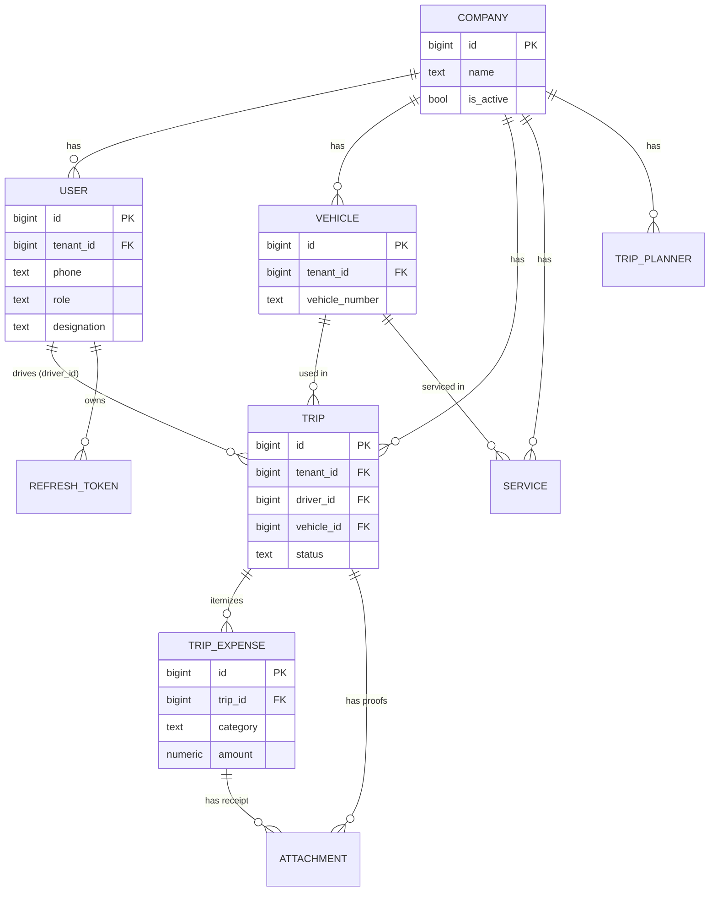
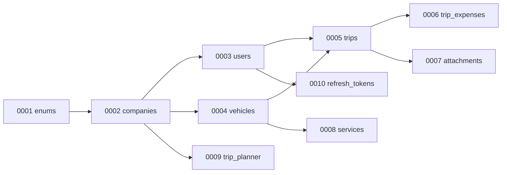
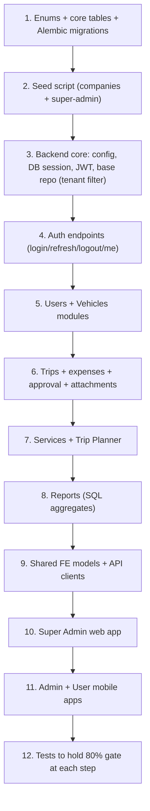

# Data Model & API Contracts
## Fleet Management System

| Field | Value |
|---|---|
| Document Title | Fleet Management System – Data Model & API Contracts |
| Version | 1.0 (Draft – complete) |
| Date | 2026-10-09 |
| Status | Draft – ready for review |
| Related | docs/business_requirement.md, docs/architecture_specification.md, docs/PROJECT-LOG.md |

---

## 1. Conventions

| Topic | Convention |
|---|---|
| Primary keys | `id BIGINT GENERATED ALWAYS AS IDENTITY` (or UUID if preferred later). |
| Tenant scoping | Every tenant-owned table has `tenant_id BIGINT NOT NULL REFERENCES companies(id)`. |
| Timestamps | `created_at TIMESTAMPTZ NOT NULL DEFAULT now()`, `updated_at TIMESTAMPTZ NOT NULL DEFAULT now()` (app bumps on update). |
| Money | `NUMERIC(12,2)` for all amounts (INR). Never floats. |
| Soft delete | `is_active BOOLEAN NOT NULL DEFAULT true` where records must be retained (no hard delete). |
| Naming | snake_case tables (plural) and columns. |
| Enforcement | `tenant_id` always taken from the JWT, never from the request body. |

**Multi-tenant model (confirmed):** `super-admin` is the top role **within one company**; each company (tenant) has its own super-admin, admins, and users. Companies and their first super-admin are **seeded directly in the database** by the product tech owner — there is no company/tenant onboarding UI in v1.

## 2. Entity Relationship Overview



## 3. Enumerations

Implemented as PostgreSQL `ENUM` types (or `TEXT` + `CHECK`).

| Enum | Values | Used by |
|---|---|---|
| `user_role` | `super_admin`, `admin`, `user` | `users.role` |
| `trip_status` | `draft`, `submitted`, `approved`, `rejected` | `trips.status` |
| `expense_category` | `fuel`, `toll`, `parking`, `permit`, `other` | `trip_expenses.category` |
| `compliance_status` | `valid`, `expired`, `pending` | `vehicles.insurance_status`, `vehicles.fc_status` |
| `attachment_kind` | `receipt`, `rc_card`, `license`, `other` | `attachments.kind` |
| `payment_status` | `unpaid`, `partial`, `paid` | `trips.payment_status` |

> Designation is free text (e.g. "Driver", "Mechanic", "Co-pilot"); when designation is "Driver", `license_number` is required (enforced in the service layer).

## 4. Table Definitions (PostgreSQL)

Illustrative DDL (the Developer agent generates the real Alembic migrations).

### 4.1 companies (tenant)

```sql
CREATE TABLE companies (
    id              BIGINT GENERATED ALWAYS AS IDENTITY PRIMARY KEY,
    name            TEXT NOT NULL,
    is_active       BOOLEAN NOT NULL DEFAULT true,
    created_at      TIMESTAMPTZ NOT NULL DEFAULT now(),
    updated_at      TIMESTAMPTZ NOT NULL DEFAULT now()
);
```

Seeded directly in DB (no onboarding UI).

### 4.2 users

```sql
CREATE TABLE users (
    id              BIGINT GENERATED ALWAYS AS IDENTITY PRIMARY KEY,
    tenant_id       BIGINT NOT NULL REFERENCES companies(id),
    name            TEXT NOT NULL,
    phone           TEXT NOT NULL,
    password_hash   TEXT NOT NULL,
    role            user_role NOT NULL,
    designation     TEXT,
    aadhaar         TEXT,
    dob             DATE,
    license_number  TEXT,                   -- required when designation = 'Driver' (app-enforced)
    description     TEXT,
    is_active       BOOLEAN NOT NULL DEFAULT true,
    created_at      TIMESTAMPTZ NOT NULL DEFAULT now(),
    updated_at      TIMESTAMPTZ NOT NULL DEFAULT now(),
    CONSTRAINT uq_users_tenant_phone UNIQUE (tenant_id, phone)
);
```

### 4.3 vehicles

```sql
CREATE TABLE vehicles (
    id                  BIGINT GENERATED ALWAYS AS IDENTITY PRIMARY KEY,
    tenant_id           BIGINT NOT NULL REFERENCES companies(id),
    vehicle_number      TEXT NOT NULL,
    insurance_till      DATE,
    insurance_status    compliance_status NOT NULL DEFAULT 'pending',
    fc_till             DATE,
    fc_status           compliance_status NOT NULL DEFAULT 'pending',
    rc_card_key         TEXT,               -- object-storage file key
    is_active           BOOLEAN NOT NULL DEFAULT true,
    created_at          TIMESTAMPTZ NOT NULL DEFAULT now(),
    updated_at          TIMESTAMPTZ NOT NULL DEFAULT now(),
    CONSTRAINT uq_vehicles_tenant_number UNIQUE (tenant_id, vehicle_number)
);
```

### 4.4 trips (job sheet)

```sql
CREATE TABLE trips (
    id              BIGINT GENERATED ALWAYS AS IDENTITY PRIMARY KEY,
    tenant_id       BIGINT NOT NULL REFERENCES companies(id),
    driver_id       BIGINT NOT NULL REFERENCES users(id),
    vehicle_id      BIGINT REFERENCES vehicles(id),
    location        TEXT,                   -- route / location
    trip_date       DATE,
    start_km        INTEGER,
    end_km          INTEGER,
    status          trip_status NOT NULL DEFAULT 'draft',
    billed_amount NUMERIC(12,2) NOT NULL DEFAULT 0,  -- fare / customer charge
    fare_gst_amount NUMERIC(12,2),                   -- optional GST on fare (nullable)
    advance_paid NUMERIC(12,2) NOT NULL DEFAULT 0,
    balance_amount NUMERIC(12,2) GENERATED ALWAYS AS (billed_amount - advance_paid) STORED,
    payment_status payment_status NOT NULL DEFAULT 'unpaid',
    created_by      BIGINT NOT NULL REFERENCES users(id),
    approved_by     BIGINT REFERENCES users(id),
    approved_at     TIMESTAMPTZ,
    created_at      TIMESTAMPTZ NOT NULL DEFAULT now(),
    updated_at      TIMESTAMPTZ NOT NULL DEFAULT now(),
    CONSTRAINT ck_trips_km CHECK (end_km IS NULL OR start_km IS NULL OR end_km >= start_km),
    CONSTRAINT ck_trips_fare CHECK (billed_amount >= 0 AND advance_paid >= 0 AND advance_paid <= billed_amount),
    CONSTRAINT ck_trips_fare_gst CHECK (fare_gst_amount IS NULL OR fare_gst_amount >= 0)
);
```

`total_km` is computed in SQL (`end_km - start_km`), not stored. `balance_amount` is a stored generated column (`billed_amount - advance_paid`). **Trip profit = `billed_amount` - total trip expenses** (computed in SQL in reports; service costs are excluded).

### 4.5 trip_expenses (itemized)

```sql
CREATE TABLE trip_expenses (
    id              BIGINT GENERATED ALWAYS AS IDENTITY PRIMARY KEY,
    tenant_id       BIGINT NOT NULL REFERENCES companies(id),
    trip_id         BIGINT NOT NULL REFERENCES trips(id) ON DELETE CASCADE,
    category        expense_category NOT NULL,
    amount          NUMERIC(12,2) NOT NULL DEFAULT 0,
    gst_amount      NUMERIC(12,2),           -- nullable; set when GST breakdown is used
    description     TEXT,
    created_at      TIMESTAMPTZ NOT NULL DEFAULT now(),
    CONSTRAINT ck_trip_expenses_amount CHECK (amount >= 0),
    CONSTRAINT ck_trip_expenses_gst CHECK (gst_amount IS NULL OR gst_amount >= 0)
);
```

### 4.6 attachments (proofs / documents)

```sql
CREATE TABLE attachments (
    id              BIGINT GENERATED ALWAYS AS IDENTITY PRIMARY KEY,
    tenant_id       BIGINT NOT NULL REFERENCES companies(id),
    trip_id         BIGINT REFERENCES trips(id) ON DELETE CASCADE,
    trip_expense_id BIGINT REFERENCES trip_expenses(id) ON DELETE CASCADE,
    file_key        TEXT NOT NULL,            -- object-storage key (tenant-prefixed)
    content_type    TEXT,
    kind            attachment_kind NOT NULL DEFAULT 'receipt',
    uploaded_by     BIGINT NOT NULL REFERENCES users(id),
    created_at      TIMESTAMPTZ NOT NULL DEFAULT now()
);
```

Multiple attachments per trip and per expense are allowed.

### 4.7 services (service & maintenance)
```sql
CREATE TABLE services (
    id                      BIGINT GENERATED ALWAYS AS IDENTITY PRIMARY KEY,
    tenant_id               BIGINT NOT NULL REFERENCES companies(id),
    vehicle_id              BIGINT NOT NULL REFERENCES vehicles(id),
    core_service            TEXT,
    spares                  TEXT,
    service_cost            NUMERIC(12,2) NOT NULL DEFAULT 0,
    other_maintenance_cost  NUMERIC(12,2) NOT NULL DEFAULT 0,
    start_date              DATE,
    est_end_date            DATE,
    end_date                DATE,
    description             TEXT,
    is_active               BOOLEAN NOT NULL DEFAULT true,
    created_at              TIMESTAMPTZ NOT NULL DEFAULT now(),
    updated_at              TIMESTAMPTZ NOT NULL DEFAULT now(),
    CONSTRAINT ck_services_costs CHECK (service_cost >= 0 AND other_maintenance_cost >= 0)
);
```

### 4.8 trip_planner (incl. quotation)
```sql
CREATE TABLE trip_planner (
    id                  BIGINT GENERATED ALWAYS AS IDENTITY PRIMARY KEY,
    tenant_id           BIGINT NOT NULL REFERENCES companies(id),
    destination_location TEXT NOT NULL,
    round_trip          BOOLEAN NOT NULL DEFAULT false,
    estimated_km        INTEGER,
    estimated_fare NUMERIC(12,2),                     -- optional quotation fare
    planned_from        DATE NOT NULL,
    planned_to          DATE NOT NULL,
    total_days          INTEGER GENERATED ALWAYS AS ((planned_to - planned_from) + 1) STORED,
    trip_notes          TEXT,
    created_by          BIGINT NOT NULL REFERENCES users(id),
    created_at          TIMESTAMPTZ NOT NULL DEFAULT now(),
    updated_at          TIMESTAMPTZ NOT NULL DEFAULT now(),
    CONSTRAINT ck_trip_planner_dates CHECK (planned_to >= planned_from)
);
```

`total_days` is a stored generated column (read-only, auto-calculated).

### 4.9 refresh_tokens
```sql
CREATE TABLE refresh_tokens (
    id              BIGINT GENERATED ALWAYS AS IDENTITY PRIMARY KEY,
    tenant_id       BIGINT NOT NULL REFERENCES companies(id),
    user_id         BIGINT NOT NULL REFERENCES users(id),
    token_hash      TEXT NOT NULL,              -- store hash, never the raw token
    expires_at      TIMESTAMPTZ NOT NULL,
    revoked         BOOLEAN NOT NULL DEFAULT false,
    created_at      TIMESTAMPTZ NOT NULL DEFAULT now()
);
```

Enables refresh-token rotation and logout/revocation.

## 5. Indexes & Constraints Summary

**Indexes** (all tenant-owned lookups lead with `tenant_id`)

| Table | Index | Purpose |
|---|---|---|
| users | `UNIQUE (tenant_id, phone)` | Login + uniqueness per company. |
| vehicles | `UNIQUE (tenant_id, vehicle_number)` | Uniqueness per company. |
| trips | `(tenant_id, driver_id)` | User "own records" filter. |
| trips | `(tenant_id, status)` | Approval queues. |
| trips | `(tenant_id, trip_date)` | Date listing/reports. |
| trip_expenses | `(tenant_id, trip_id)` | Expense rollups per trip. |
| services | `(tenant_id, vehicle_id)` | Vehicle service logs. |
| attachments | `(tenant_id, trip_id)`, `(tenant_id, trip_expense_id)` | Proof lookups. |
| trip_planner | `(tenant_id, planned_from)` | Planner listing. |
| refresh_tokens | `(user_id)`, `(token_hash)` | Token lookup/rotation. |

**Key constraints**

| Constraint | Rule |
|---|---|
| `ck_trips_km` | `end_km >= start_km` when both set. |
| `ck_trip_expenses_amount` | `amount >= 0`. |
| `ck_trip_planner_dates` | `planned_to >= planned_from`. |
| `ck_services_costs` | costs `>= 0`. |
| Foreign keys | All child rows reference their parent; expenses/attachments cascade on trip delete. |
| App-level rule | `license_number` required when `designation = 'Driver'`. |

## 6. Migration Plan (Alembic)

Schema changes are versioned with **Alembic** (confirmed). Order of the initial migrations respects foreign-key dependencies:



| Rule | Detail |
|---|---|
| Autogenerate | Use `alembic revision --autogenerate` from SQLAlchemy models, then review. |
| Reversible | Every migration has a working `downgrade`. |
| Seed data | Companies + first super-admin seeded via a separate seed script (not a schema migration). |
| Enums first | Create enum types before the tables that use them. |

## 7. API Conventions

| Topic | Convention |
|---|---|
| Base path | `/api/v1` |
| Format | JSON request/response; `Authorization: Bearer <access_token>`. |
| Pagination | Query `?page=1&page_size=20`; response `{ items, page, page_size, total }`. |
| Filtering | Query params per resource (e.g. `?status=submitted`), applied in SQL. |
| Sorting | `?sort=field` / `?sort=-field` (descending). |
| Tenant | Derived from token `tenant_id`; never accepted from the client. |
| IDs | Numeric path params, e.g. `/trips/{trip_id}`. |
| Timestamps | ISO-8601 UTC. |
| Errors | `{ "error": { "code", "message", "details?" } }`. |

**Common status codes**

| Code | Meaning |
|---|---|
| 200 | OK (read/update) |
| 201 | Created |
| 204 | No content (delete/logout) |
| 400 | Bad request |
| 401 | Unauthenticated (missing/invalid/expired token) |
| 403 | Forbidden (role/tenant/own-record violation) |
| 404 | Not found (or hidden cross-tenant resource) |
| 409 | Conflict (e.g. duplicate phone/vehicle number) |
| 422 | Validation error |

## 8. Auth Endpoints

| Method | Path | Body | Success | Roles |
|---|---|---|---|---|
| POST | `/api/v1/auth/login` | `{ phone, password }` | `200 { access_token, refresh_token, user }` | public |
| POST | `/api/v1/auth/refresh` | `{ refresh_token }` | `200 { access_token }` | public (valid refresh token) |
| POST | `/api/v1/auth/logout` | `{ refresh_token }` | `204` | authenticated |
| GET | `/api/v1/auth/me` | – | `200 { user }` | authenticated |

**Login response `user` shape**
```json
{
  "id": 1,
  "name": "...",
  "phone": "...",
  "role": "user",
  "designation": "Driver"
}
```

- Invalid credentials → `401`.
- Access token TTL 15 min; refresh token TTL 7 days (rotated on refresh).

## 9. User Management Endpoints

Not accessible to the `user` role.

| Method | Path | Body | Success | Roles |
|---|---|---|---|---|
| GET | `/api/v1/users` | – (`?page&page_size&role&search`) | `200 { items, page, page_size, total }` | super_admin, admin |
| POST | `/api/v1/users` | create payload | `201 { user }` | super_admin, admin |
| GET | `/api/v1/users/{id}` | – | `200 { user }` | super_admin, admin |
| PATCH | `/api/v1/users/{id}` | partial payload | `200 { user }` | super_admin, admin |
| DELETE | `/api/v1/users/{id}` | – | `204` | super_admin |

**Create payload**
```json
{
  "name": "string",
  "phone": "string",
  "password": "string",
  "role": "user | admin | super_admin",
  "designation": "Driver | Mechanic | Co-pilot | ...",
 "aadhaar": "string | null",
  "dob": "YYYY-MM-DD | null",
  "license_number": "string | null",
  "description": "string | null"
}
```
- `license_number` required when `designation = "Driver"` → else `422`.
- Duplicate `phone` within the company → `409`.

## 10. Vehicle Endpoints

Not accessible to the `user` role.

| Method | Path | Body | Success | Roles |
|---|---|---|---|---|
| GET | `/api/v1/vehicles` | – (`?page&page_size&search`) | `200 { items, ... }` | super_admin, admin |
| POST | `/api/v1/vehicles` | create payload | `201 { vehicle }` | super_admin, admin |
| GET | `/api/v1/vehicles/{id}` | – | `200 { vehicle }` | super_admin, admin |
| PATCH | `/api/v1/vehicles/{id}` | partial payload | `200 { vehicle }` | super_admin, admin |
| DELETE | `/api/v1/vehicles/{id}` | – | `204` | super_admin |
| GET | `/api/v1/vehicles/{id}/services` | – | `200 { items, ... }` | super_admin, admin |

**Create payload**
```json
{
  "vehicle_number": "string",
  "insurance_till": "YYYY-MM-DD | null",
  "insurance_status": "valid | expired | pending",
  "fc_till": "YYYY-MM-DD | null",
  "fc_status": "valid | expired | pending",
  "rc_card_key": "string | null"
}
```
- Duplicate `vehicle_number` within the company → `409`.

## 11. Trip Endpoints (incl. expenses & approval)

All roles access trips. The `user` role is restricted to **their own** trips
(`driver_id = token.sub`), enforced server-side.

| Method | Path | Body | Success | Roles |
|---|---|---|---|---|
| POST | `/api/v1/trips` | create payload | `201 { trip }` | super_admin, admin |
| GET | `/api/v1/trips` | – (`?page&page_size&status&driver_id&date_from&date_to`) | `200 { items, ... }` | all (user: own only) |
| GET | `/api/v1/trips/{id}` | – | `200 { trip }` | all (user: own only) |
| PATCH | `/api/v1/trips/{id}` | partial payload | `200 { trip }` | all (user: own only) |
| DELETE | `/api/v1/trips/{id}` | – | `204` | super_admin |
| POST | `/api/v1/trips/{id}/submit` | – | `200 { trip }` | all (user: own only) |
| POST | `/api/v1/trips/{id}/approve` | – | `200 { trip }` | super_admin, admin |
| POST | `/api/v1/trips/{id}/reject` | `{ reason? }` | `200 { trip }` | super_admin, admin |

**Trip create payload**
```json
{
  "driver_id": 1,
  "vehicle_id": 2,
  "location": "string",
  "trip_date": "YYYY-MM-DD",
  "start_km": 1000,
  "end_km": 1250,
  "billed_amount": 5000.00,
  "fare_gst_amount": 250.00,
  "advance_paid": 2000.00,
  "payment_status": "unpaid | partial | paid"
}
```
- Fare fields may be set/edited by **all roles** (including the driver/user on their own trip). `balance_amount` is server-computed.

**Trip response (computed fields in SQL)**
```json
{
  "id": 10, "status": "submitted",
  "driver": { "id": 1, "name": "..." },
  "vehicle": { "id": 2, "vehicle_number": "..." },
  "start_km": 1000, "end_km": 1250, "total_km": 250,
  "billed_amount": 5000.00, "fare_gst_amount": 250.00,
  "advance_paid": 2000.00, "balance_amount": 3000.00, "payment_status": "partial",
  "total_expense": 3200.00,
  "profit": 1800.00,
  "approved_by": null, "approved_at": null
}
```
> **Profit visibility:** `profit` (= `billed_amount` - `total_expense`) is **omitted** from the response for the `user` role. The driver sees the fare and expenses but not the profit figure; profit reporting is super-admin only.

**Nested expense endpoints**
| Method | Path | Body | Success | Roles |
|---|---|---|---|---|
| GET | `/api/v1/trips/{id}/expenses` | – | `200 { items }` | all (user: own trip) |
| POST | `/api/v1/trips/{id}/expenses` | `{ category, amount, gst_amount?, description? }` | `201 { expense }` | all (user: own trip) |
| PATCH | `/api/v1/trips/{id}/expenses/{expense_id}` | partial | `200 { expense }` | all (user: own trip) |
| DELETE | `/api/v1/trips/{id}/expenses/{expense_id}` | – | `204` | super_admin, admin |

**Approval rules**
- `submit`: moves `draft`/`rejected` → `submitted`.
- `approve`/`reject`: any admin or super-admin acts on a `submitted` trip; sets
  `approved_by` + `approved_at` (single-level approval).
- Approving a trip not in `submitted` → `409`.

## 12. Service Endpoints

All roles may Create/Read/Update; only super_admin may Delete.

| Method | Path | Body | Success | Roles |
|---|---|---|---|---|
| GET | `/api/v1/services` | – (`?page&page_size&vehicle_id`) | `200 { items, ... }` | all |
| POST | `/api/v1/services` | create payload | `201 { service }` | all |
| GET | `/api/v1/services/{id}` | – | `200 { service }` | all |
| PATCH | `/api/v1/services/{id}` | partial payload | `200 { service }` | all |
| DELETE | `/api/v1/services/{id}` | – | `204` | super_admin |

**Create payload**
```json
{
  "vehicle_id": 2,
  "core_service": "string",
  "spares": "string",
  "service_cost": 1500.00,
  "other_maintenance_cost": 300.00,
  "start_date": "YYYY-MM-DD",
  "est_end_date": "YYYY-MM-DD",
  "end_date": "YYYY-MM-DD | null",
  "description": "string | null"
}
```

## 13. Trip Planner Endpoints

Not accessible to the `user` role. Covers planning + quotation.

| Method | Path | Body | Success | Roles |
|---|---|---|---|---|
| GET | `/api/v1/trip-planner` | – (`?page&page_size`) | `200 { items, ... }` | super_admin, admin |
| POST | `/api/v1/trip-planner` | create payload | `201 { plan }` | super_admin, admin |
| GET | `/api/v1/trip-planner/{id}` | – | `200 { plan }` | super_admin, admin |
| PATCH | `/api/v1/trip-planner/{id}` | partial payload | `200 { plan }` | super_admin, admin |
| DELETE | `/api/v1/trip-planner/{id}` | – | `204` | super_admin |

**Create payload**
```json
{
  "destination_location": "string",
  "round_trip": true,
  "estimated_km": 450,
  "estimated_fare": 6000.00,
  "planned_from": "YYYY-MM-DD",
  "planned_to": "YYYY-MM-DD",
  "trip_notes": "string | null"
}
```
- `total_days` is server-computed (read-only) and returned in the response.
- `estimated_fare` is optional (the expected quotation fare before the trip).

## 14. File / Attachment Endpoints

Files are uploaded directly to object storage via short-lived signed URLs; the API
only issues URLs and stores keys.

| Method | Path | Body | Success | Roles |
|---|---|---|---|---|
| POST | `/api/v1/files/upload-url` | `{ kind, content_type }` | `200 { upload_url, file_key }` | authenticated |
| GET | `/api/v1/files/{file_key}/url` | – | `200 { download_url }` | authenticated (tenant-scoped key) |
| POST | `/api/v1/trips/{id}/attachments` | `{ file_key, kind, trip_expense_id? }` | `201 { attachment }` | all (user: own trip) |
| GET | `/api/v1/trips/{id}/attachments` | – | `200 { items }` | all (user: own trip) |
| DELETE | `/api/v1/trips/{id}/attachments/{attachment_id}` | – | `204` | super_admin, admin |

- File keys are tenant-prefixed; requesting another tenant's key → `404`.
- Signed URLs are short-lived; content-type and size validated on issuance.

## 15. Reports Endpoints

Read-only, super_admin only. Figures computed in SQL.

| Method | Path | Query | Success | Roles |
|---|---|---|---|---|
| GET | `/api/v1/reports/expense-summary` | `?date_from&date_to&vehicle_id?` | `200 { summary }` | super_admin |
| GET | `/api/v1/reports/trip-profit` | `?date_from&date_to` | `200 { items, totals }` | super_admin |

**Expense summary response (illustrative)**
```json
{
  "period": { "from": "2026-10-01", "to": "2026-10-31" },
  "by_category": { "fuel": 42000.00, "toll": 8000.00, "parking": 1500.00,
                   "permit": 3000.00, "other": 2500.00 },
  "service_cost": 12000.00,
  "total_expense": 69000.00
}
```

**Trip profit response (illustrative)** — `profit = billed_amount - trip expenses` (service costs are **excluded** from trip profit).

```json
{
  "period": { "from": "2026-10-01", "to": "2026-10-31" },
  "items": [
    { "trip_id": 10, "billed_amount": 5000.00, "total_expense": 3200.00, "profit": 1800.00 }
  ],
  "totals": { "revenue": 5000.00, "expense": 3200.00, "profit": 1800.00 }
}
```

## 16. Endpoint → Role Matrix

*(C = Create, R = Read/List, U = Update, D = Delete; – = no access)*

| Resource | super_admin | admin | user |
|---|---|---|---|
| Auth (login/refresh/logout/me) | ✓ | ✓ | ✓ |
| Users | C R U D | C R U | – |
| Vehicles | C R U D | C R U | – |
| Trips | C R U D | C R U | R U (own only) |
| Trip approve/reject | ✓ | ✓ | – |
| Trip submit | ✓ | ✓ | ✓ (own) |
| Trip expenses | C R U D | C R U D | C R U (own trip) |
| Trip attachments | C R D | C R D | C R (own trip) |
| Services | C R U D | C R U | C R U |
| Trip Planner | C R U D | C R U | – |
| Reports | R | – | – |
| Files (signed URLs) | ✓ | ✓ | ✓ |

## 17. Testing Strategy & Fixtures

Target: ≥ 80% line and branch coverage (build gate).

| Layer | Tool | Focus | Fixtures the Validator needs |
|---|---|---|---|
| Unit (services) | pytest + mocks | Role/own-record rules, approval state machine, license-required rule, GST handling | Mocked repositories, fake JWT context (tenant/role/user) |
| Integration (repos) | pytest-asyncio + asyncpg | SQL aggregates (`total_km`, `total_expense`), tenant filtering, constraints | Test PostgreSQL schema, per-test transaction rollback, seed companies/users/vehicles/trips |
| API E2E | pytest + httpx | Status codes, auth gates, pagination, cross-tenant isolation | Seeded two tenants + tokens per role |

**Critical test cases**
- User cannot read/update another user's trip → `403/404`.
- Tenant A cannot see Tenant B rows (every list + get).
- `end_km < start_km` → `422`.
- Approve a non-`submitted` trip → `409`.
- Driver designation without `license_number` → `422`.
- Duplicate phone / vehicle number → `409`.
- Expired access token → `401`; refresh issues a new one.

**Seed data strategy:** two companies (tenants), each with one super_admin, one admin,
one driver user, one vehicle, and a few trips in different statuses — enough to prove
isolation and role rules.

## 18. Implementation Order

Database and contract first, then backend, then the apps.



| Step | Depends on | Deliverable |
|---|---|---|
| 1-2 | – | Migrated schema + seeded tenant/super-admin. |
| 3-4 | 1-2 | Working auth + tenant-scoped base. |
| 5-8 | 3-4 | Backend feature APIs with tests. |
| 9 | 5-8 | Typed API clients + models (shared). |
| 10-11 | 9 | Web app, then mobile apps. |
| 12 | all | Coverage gate green across layers. |