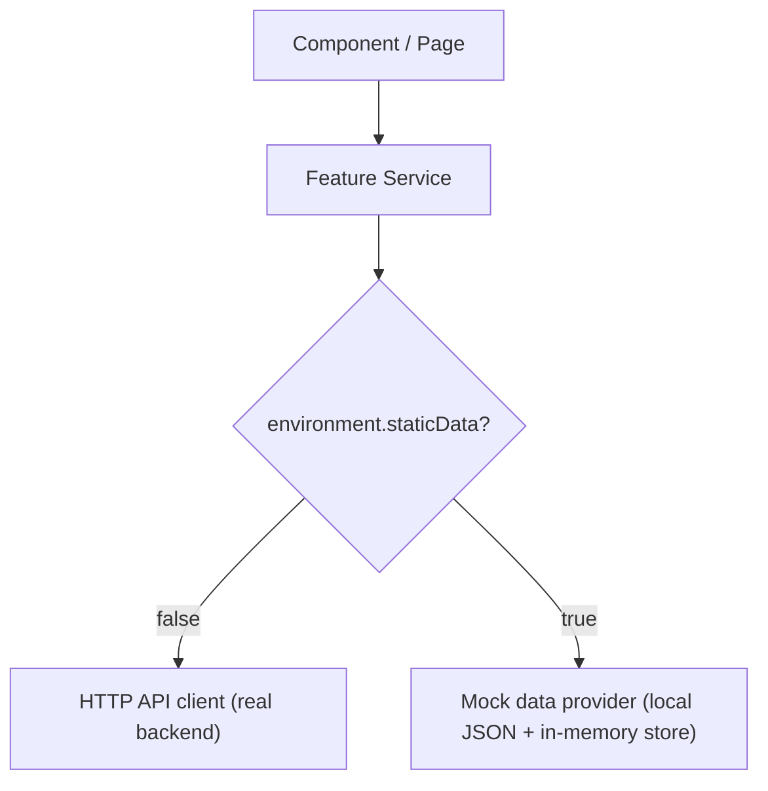

# Demo / Static Data Mode (`staticData` flag)
## Fleet Management System

| Field | Value |
|---|---|
| Version | 1.0 (Draft) |
| Date | 2026-10-10 |
| Status | Draft — ready for review |
| Related | docs/configuration_and_environments.md, docs/api_integration_guide.md, docs/data_model_and_api_contracts.md |

> Purpose: let the frontend run entirely on **local dummy JSON** for demos/dev — no backend required — controlled by a single boolean. When off, the apps use the real API as normal. Applies to **all three apps** (web + both mobile).

---

## 1. The flag

A build-time boolean in each app's `environment.ts`:

```ts
export const environment = {
  production: false,
  apiBaseUrl: 'http://localhost:8000/api/v1',
  staticData: true,       // true = local dummy JSON; false = real backend API
  demoRole: 'super_admin', // role used for the fake session in static mode
};
```

| `staticData` | Behavior |
|---|---|
| `false` | All data comes from the real backend API (normal operation). |
| `true` | All data comes from local dummy JSON; no network calls to the API. |

> Build-time flag: a "demo build" ships with `staticData: true`; the real build sets it `false`. There is no runtime toggle.

---

## 2. How the switch works (one place only)

Components never know which mode is active. The **feature services** ask a single `DataSource` which returns either the HTTP client or the mock provider based on the flag.



- Only the data-source layer reads `staticData`. Everything above it is identical in both modes.
- Keep this in `frontend/shared` so all three apps reuse the same switch.

---

## 3. Mock data

| Item | Convention |
|---|---|
| Location | `src/assets/mock/*.json` per app (seed copies), shapes defined in `frontend/shared`. |
| Shape | **Must match the API response DTOs exactly** (including pagination wrapper `{ items, page, page_size, total }`). |
| Content | **Fake data only** — never real customer/PII data. |
| Files | One per resource: `users.json`, `vehicles.json`, `trips.json`, `trip-expenses.json`, `services.json`, `trip-planner.json`, `reports.json`. |

---

## 4. Write behavior (interactive demo)

In static mode, create/update/delete/approve are **simulated in memory**:
- A mock store loads the JSON into in-memory arrays at startup.
- Create/Update/Delete/Approve mutate those arrays so the demo feels real.
- **Changes vanish on reload** (the store re-seeds from JSON). This is expected.

---

## 5. Login in static mode

- The **normal login screen is shown**, but **any credentials pass** (no real auth).
- On submit, a **fake session** is created and the user is signed in as `environment.demoRole` (per app: web → `super_admin`/`admin`, admin app → `admin`, user app → `user`).
- No real token is issued; the HTTP interceptor and refresh flow are bypassed while `staticData` is true.

---

## 6. Rules & guardrails

| Rule | Reason |
|---|---|
| Frontend-only | The flag must never affect the backend or its behavior. |
| Fake data only | Static mode bypasses auth; mock files must contain no real data. |
| Same contracts | Mock JSON matches API DTOs so switching modes needs no component changes. |
| Not for real prod | Don't ship `staticData: true` as the live production app; use it only for demo builds. |
| Single switch | Only the data-source layer checks the flag; never scatter `if (staticData)` across components. |

---

## 7. Testing considerations

- Unit-test the `DataSource`/mock provider: given `staticData=true`, services return mock data and simulate writes; given `false`, they call the HTTP client (mocked).
- Mock JSON files double as test fixtures.
- This keeps both modes covered toward the 80% gate.

---

## 8. Developer checklist (per feature)

- [ ] Add a matching `*.json` fixture with DTO-correct shape.
- [ ] Route all data access through the shared `DataSource` (no direct HTTP in components).
- [ ] Simulate writes in the in-memory store for static mode.
- [ ] Verify the feature works identically with `staticData` true and false.