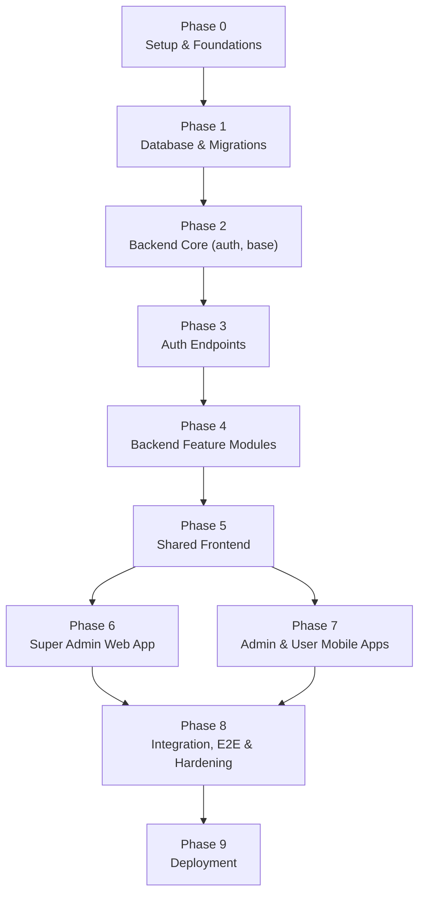
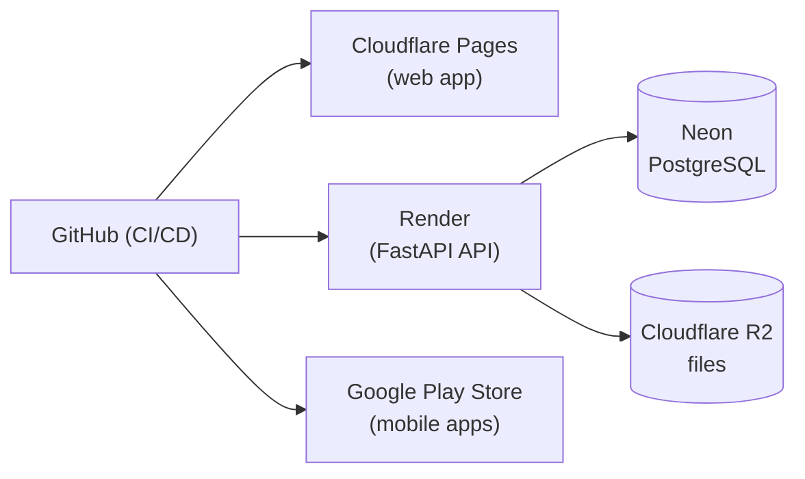

# Implementation Plan
## Fleet Management System

| Field | Value |
|---|---|
| Document Title | Fleet Management System – Implementation Plan |
| Version | 1.0 (Draft – complete) |
| Date | 2026-10-09 |
| Status | Draft – ready for review |
| Related | docs/business_requirement.md, docs/architecture_specification.md, docs/data_model_and_api_contracts.md, docs/PROJECT-LOG.md |

---

## 1. Purpose & How to Use This Plan

This plan sequences the full build of the Fleet Management System across all phases, from project setup to deployment. It is **dependency-ordered**: database and contracts first, then backend, then the frontends, then deployment.

Each phase lists: goal, tasks, owning agent, deliverables, tests, and exit criteria (what must be true before the next phase starts). The **developer** agent implements, the **validator** agent verifies tests and the 80% coverage gate, and the **architect** updates design docs if a decision changes.

## 2. Guiding Rules (apply to every phase)

| Rule | Detail |
|---|---|
| Design is the source of truth | Build to the BRD, architecture spec, and data model & API contracts. |
| Backend-first | A feature's API + tests land before the UI that consumes it. |
| Tests with every change | No feature is "done" without unit tests; build fails below 80% line + branch coverage. |
| Thin server | Calculations (totals, KM, rollups) in SQL; services orchestrate. |
| Tenant isolation always | Every query filters by `tenant_id` from the JWT. |
| Security at the boundary | Validate input, authorize server-side, never trust the client. |
| UI-kit boundary | Angular Material/AG Grid/Bootstrap = web only; Ionic = mobile only. Share models/services, never UI. |
| Keep the log current | Record any new tool/decision in `docs/PROJECT-LOG.md`. |

## 3. Phase Roadmap (overview)

| Phase | Title | Primary owner | Depends on |
|---|---|---|---|
| 0 | Setup & Foundations | developer | — |
| 1 | Database & Migrations | developer | 0 |
| 2 | Backend Core | developer | 1 |
| 3 | Auth Endpoints | developer | 2 |
| 4 | Backend Feature Modules | developer | 3 |
| 5 | Shared Frontend | developer | 4 |
| 6 | Super Admin Web App | developer | 5 |
| 7 | Admin & User Mobile Apps | developer | 5 |
| 8 | Integration, E2E & Hardening | validator | 6, 7 |
| 9 | Deployment | developer | 8 |

## 4. Phase 0 – Project Setup & Foundations

**Goal:** a working monorepo, tooling, and local dev environment (no Docker).

**Tasks**
- Create monorepo: `backend/`, `frontend/super-admin-web/`, `frontend/admin-app/`, `frontend/user-app/`, `frontend/shared/`.
- Backend: init with `uv`; add FastAPI, Uvicorn, Pydantic v2, SQLAlchemy, asyncpg, Alembic, PyJWT, passlib[bcrypt]; configure Ruff, mypy, pytest, pre-commit.
- Frontends: scaffold Angular 20 web app (Material + CDK, AG Grid Community, Bootstrap 5, SCSS); scaffold two Ionic 8 + Capacitor 7 apps; configure ESLint + Prettier, Jasmine + Karma, Playwright.
- Set up GitHub repo + CI skeleton (lint, type-check, test, coverage gate at 80%).
- Add `.env.example` for each app (DB URL, JWT secret, R2 creds) – no secrets committed.

**Deliverables:** repo scaffolds that build and run locally; green empty CI.
**Tests:** CI runs lint/type/test on a trivial sample and enforces the coverage gate.
**Exit criteria:** every app starts locally; CI is green; pre-commit hooks active.

## 5. Phase 1 – Database & Migrations

**Goal:** the PostgreSQL schema exists and is reproducible.

**Tasks**
- Define SQLAlchemy models for all tables in the data model doc.
- Create enum types, then tables, via Alembic migrations in FK-dependency order (companies → users/vehicles → trips → expenses/attachments → services → planner → refresh_tokens).
- Add indexes, unique constraints, and CHECK constraints.
- Write a **seed script** (companies + first super-admin) – separate from migrations.
- Configure a local + test PostgreSQL (Neon for shared/remote later).

**Deliverables:** migrations that build the full schema; seed script.
**Tests:** integration test that applies migrations to a fresh test DB and asserts key constraints (unique phone, `end_km >= start_km`, generated `total_days`).
**Exit criteria:** `alembic upgrade head` builds the schema; downgrade works; seed runs.

## 6. Phase 2 – Backend Core (config, auth, base)

**Goal:** shared backend foundations every feature module reuses.

**Tasks**
- Config loader (env vars), async DB session/engine, FastAPI app factory.
- Security: JWT issue/verify (PyJWT), password hashing (passlib bcrypt), token claims (`sub`, `tenant_id`, `role`, `exp`), refresh-token rotation + storage.
- FastAPI dependencies: current-user, role-gate, and a **tenant-scoped base repository** that always applies `WHERE tenant_id = :t`.
- Central error handling + consistent error shape; request/tenant/user logging.
- Pagination helper.

**Deliverables:** reusable core package (`app/core`) + base repository.
**Tests:** unit tests for JWT encode/decode/expiry, password hashing, role dependency, and that the base repository injects the tenant filter.
**Exit criteria:** a trivial protected endpoint enforces auth + tenant + role correctly.

## 7. Phase 3 – Auth Endpoints

**Goal:** users can log in and stay logged in.

**Tasks**
- `POST /auth/login` (phone + password) → access + refresh tokens + user.
- `POST /auth/refresh` → new access token (rotate refresh).
- `POST /auth/logout` → revoke refresh token.
- `GET /auth/me` → current user.

**Deliverables:** working auth module.
**Tests:** unit (service logic) + API E2E (httpx): valid login, wrong password → 401, expired access → 401, refresh issues new token, logout revokes.
**Exit criteria:** full login → use → refresh → logout cycle passes; coverage ≥ 80%.

## 8. Phase 4 – Backend Feature Modules

**Goal:** all feature APIs implemented to the contracts, backend-first.

Build in this order (each = routers + services + repositories + schemas + tests):

| # | Module | Key points |
|---|---|---|
| 4.1 | Users | CRUD; super_admin full, admin no-delete; license-required-for-Driver rule; duplicate phone → 409. |
| 4.2 | Vehicles | CRUD; same role split; duplicate vehicle number → 409; RC card key. |
| 4.3 | Trips + expenses | Create (admin/super), list/get/update (all; user own-only), delete (super); itemized expenses; `total_km`/`total_expense` in SQL. |
| 4.4 | Trip approval | `submit` / `approve` / `reject` state machine; single-level; set `approved_by`/`approved_at`; wrong state → 409. |
| 4.5 | Attachments + files | Signed upload/download URLs; multiple attachments per trip/expense; tenant-prefixed keys. |
| 4.6 | Services | CRUD all roles, delete super only; linked to vehicle; costs ≥ 0. |
| 4.7 | Trip Planner | CRUD admin/super; generated `total_days`; date validation. |
| 4.8 | Reports | super_admin only; expense summary + trip profit via SQL aggregates. |

**Deliverables:** every endpoint in the API contracts doc, working and tested.
**Tests:** unit (rules, role gates, state machine) + integration (SQL aggregates, tenant isolation) + API E2E (status codes, pagination). Cross-tenant isolation tested on every list/get.
**Exit criteria:** all endpoints match the contract; coverage ≥ 80%; isolation proven.

## 9. Phase 5 – Shared Frontend (models & API clients)

**Goal:** one typed contract layer the three apps reuse (no UI sharing).

**Tasks**
- TypeScript interfaces/DTOs matching backend schemas (User, Vehicle, Trip, Expense, Service, TripPlanner, Report).
- Typed API client functions (one per resource) using the shared base URL + auth header.
- Shared validators/formatters (money, dates, phone) and an auth/token helper.

**Deliverables:** `frontend/shared/` package consumed by all three apps.

**Tests:** unit tests for API clients (mocked HTTP) and validators/formatters.

**Exit criteria:** web and mobile apps can import shared models/clients; tests green.

## 10. Phase 6 – Super Admin Web App (Angular)

**Goal:** full web app for the super-admin (and admin where applicable).

**Tasks**
- Auth + route guards by role; token storage + refresh interceptor.
- Shell/layout with Angular Material; state via Angular Signals.
- Modules: Users, Vehicles, Trips (+expenses, approval), Services, Trip Planner, Reports.
- Use **AG Grid Community** for list screens (paginated, server-side filter/sort).
- Trip stepper UI (Trip Info → Odometer → Expenses → Review & Submit).
- Reports dashboard (expense/profit) reading SQL-computed figures.

**Deliverables:** deployable Angular app covering all web-accessible modules.
**Tests:** Jasmine + Karma unit tests (components, services, signals); Playwright E2E for login, create trip, approve, user/vehicle CRUD.
**Exit criteria:** all web flows work against the API; coverage ≥ 80%.

## 11. Phase 7 – Admin & User Mobile Apps (Ionic)

**Goal:** two mobile apps using Ionic components only.

**Tasks**
- **Admin app:** login; manage Users, Vehicles, Trips (create + approve), Services, Trip Planner.
- **User app:** login; view own trips, record trip (stepper), add expenses + receipt photos, submit for approval; create/update Services.
- Capacitor integration for Android build + camera/file capture for receipts.
- Auth + refresh; Angular Signals for state; share models/clients from `frontend/shared/`.

**Deliverables:** two installable Ionic apps (Android).
**Tests:** Jasmine + Karma unit tests; Playwright (web E2E of Ionic) for key flows (login, record trip, submit, add expense photo).
**Exit criteria:** core mobile journeys work against the API; coverage ≥ 80%.

## 12. Phase 8 – Integration, E2E & Hardening

**Goal:** prove the whole system works end to end and is secure.

**Tasks**
- Cross-app E2E: web + mobile against a shared staging API.
- Security pass: auth gates, tenant isolation, input validation, signed-URL limits, no secrets in logs/mobile storage, CORS locked to known origins.
- Performance sanity: paginated lists, SQL aggregates, no N+1 queries.
- Fix defects found by the validator; re-run full suites.

**Deliverables:** passing integration/E2E suites; security checklist signed off.
**Tests:** full pytest + httpx (API E2E), Playwright (web/Ionic E2E), coverage report.
**Exit criteria:** all suites green; coverage ≥ 80% everywhere; security checklist clear.

## 13. Phase 9 – Deployment

**Goal:** everything live on the chosen managed services.

**Tasks**
- Provision Neon (prod DB); run migrations; seed first company + super-admin.
- Deploy API to Render (always-on Starter); set env vars (DB URL, JWT secret, R2 creds).
- Deploy web app to Cloudflare Pages; point to prod API; lock CORS.
- Configure Cloudflare R2 bucket + credentials for signed URLs.
- Build Android apps with Capacitor; publish to Google Play Store.
- Set up CI/CD so GitHub pushes deploy web + API automatically.

**Deliverables:** live web app, live API, live DB + storage, published mobile apps.
**Tests:** post-deploy smoke tests (login, create trip, upload receipt, report).
**Exit criteria:** production smoke tests pass; rollback path documented.

## 14. Agent Responsibilities (who does what)

| Agent | Role in this plan |
|---|---|
| architect | Owns the design docs; updates them if a decision changes; resolves new open questions. |
| developer | Implements each phase (backend, web, mobile); writes unit tests with every change. |
| validator | Runs/verifies tests, enforces the 80% coverage gate, hunts bugs, edge cases, security gaps. |
| domain-modeler | (Optional) produces a DDD domain model from the BRD if deeper modeling is needed. |
| Explore | Fast read-only codebase Q&A during implementation. |

## 15. Definition of Done & Coverage Gates

A phase (and each feature) is **Done** when:
- It matches the API contract and data model exactly.
- Server-side authorization, tenant isolation, and input validation are enforced.
- Unit + integration + E2E tests (as relevant) pass.
- Line **and** branch coverage ≥ 80% (build fails otherwise).
- Lint (Ruff/ESLint), format (Prettier), and types (mypy) are clean.
- Any new tool/decision is recorded in `docs/PROJECT-LOG.md`.

## 16. Risks & Mitigations

| Risk | Impact | Mitigation |
|---|---|---|
| "Calculation in DB only" makes some logic hard to unit-test | Coverage/clarity | Keep hard-to-SQL rules in services; cover SQL with integration tests. |
| Row-level multi-tenancy relies on never forgetting the filter | Cross-tenant data leak | Centralized tenant filter in base repository; isolation tests on every list/get. |
| Render free tier sleeps | Slow first request | Use paid Starter for production; free only for dev. |
| Mobile receipt uploads bypass the API | Unvalidated files | Validate content-type/size on signed-URL issuance; tenant-prefixed keys. |
| Scope creep on mobile (offline) | Delays v1 | Offline is explicitly deferred; online-only for v1. |
| Coverage gate stalls delivery | Blocked builds | Write tests alongside code, not after; design for testability (seams, injectable deps). |