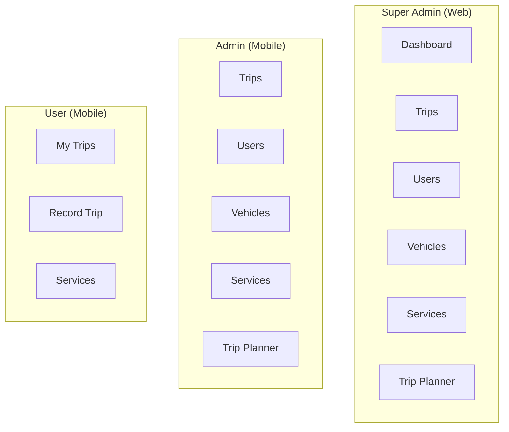
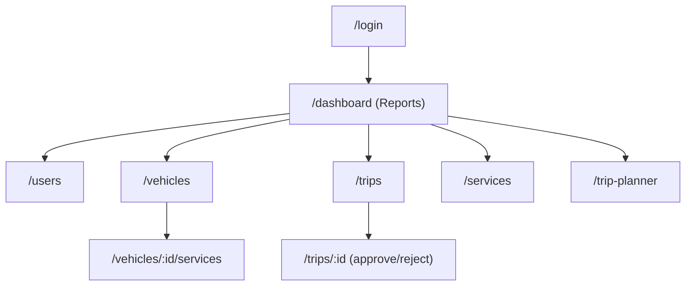
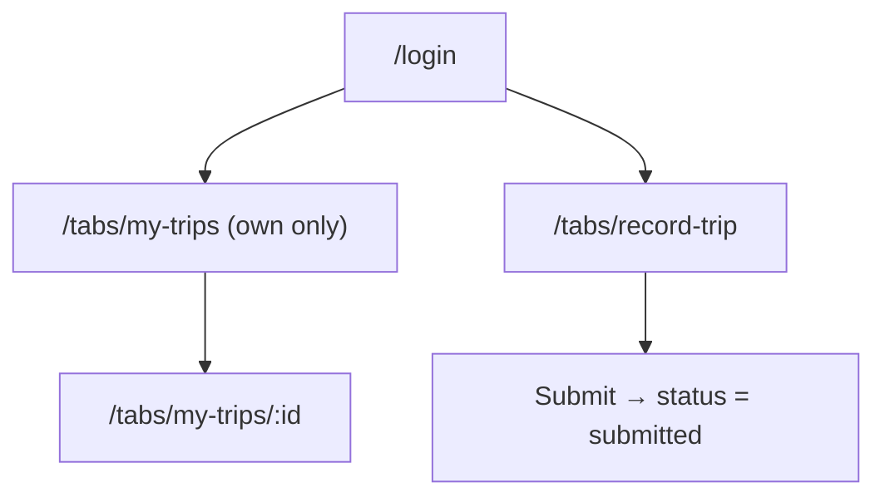

# Navigation Map (Screens & Routes)
## Fleet Management System

| Field | Value |
|---|---|
| Version | 1.0 (Draft) |
| Date | 2026-10-10 |
| Status | Draft — ready for review |
| Related | docs/business_requirement.md, docs/ui_design_system_and_frontend_conventions.md, docs/data_model_and_api_contracts.md |

> Defines the screens, routes, menus, and guards for each app so every developer builds the same navigation. Routes are enforced by **role guards**; the backend also authorizes every request.

---

## 1. Apps & who uses them

| App | Roles | UI kit |
|---|---|---|
| Super Admin Web | super_admin (+ admin where noted) | Angular Material / AG Grid |
| Admin Mobile | admin, super_admin | Ionic |
| User Mobile | user | Ionic |

All apps start at **Login**; on success, route by role to that app's home.

---

## 1A. Menus per Role (concept view)

Each role uses its own app, so the menu differs per role. Menus are driven by the permission matrix (BRD §4.2).

### Super Admin — Web app (full access)

| Menu | Concept / what it opens |
|---|---|
| Dashboard | Expense & Profit reports (owner-only) |
| Trips | All trips — create, view, edit, approve/reject, delete |
| Users | Manage all people — create, edit, delete |
| Vehicles | Manage fleet — create, edit, delete + service logs |
| Services | Service & maintenance — create, edit, delete |
| Trip Planner | Quotation / planning — create, edit, delete |

### Admin — Mobile app (manage; no delete, no profit)

| Menu | Concept / what it opens |
|---|---|
| Trips | All trips — create, view, edit, approve/reject (no delete) |
| Users | Manage people — create, edit (no delete) |
| Vehicles | Manage fleet — create, edit (no delete) |
| Services | Service & maintenance — create, edit |
| Trip Planner | Quotation / planning — create, edit |
| *(No Dashboard)* | Admins do not see profit reports |

### User (Driver / Crew) — Mobile app (own work only)

| Menu | Concept / what it opens |
|---|---|
| My Trips | Only **their own** trips — view & edit |
| Record Trip | Create/record a trip (Info → Odometer → Fare → Expenses → Submit) |
| Services | Service & maintenance — create, view, edit |
| *(No Users / Vehicles / Reports)* | No access to those |

**Key differences:** Reports/Dashboard = Super Admin only · Delete = Super Admin only · Users & Vehicles menus = Super Admin & Admin only · Approve/Reject = Super Admin & Admin only · User app = own trips + record trip + services.

---

## 2. Super Admin Web App — routes

| Route | Screen | Roles | Notes |
|---|---|---|---|
| `/login` | Login | public | phone + password |
| `/dashboard` | Reports / Expense & Profit | super_admin | home for super_admin |
| `/users` | User list | super_admin, admin | AG Grid, paginated |
| `/users/new` | Create user | super_admin, admin | - |
| `/users/:id` | Edit user | super_admin, admin | delete = super_admin only |
| `/vehicles` | Vehicle list | super_admin, admin | AG Grid |
| `/vehicles/new` · `/vehicles/:id` | Create/Edit vehicle | super_admin, admin | delete = super_admin |
| `/vehicles/:id/services` | Service logs for vehicle | super_admin, admin | - |
| `/trips` | Trip list | super_admin, admin | filters: status/date/driver |
| `/trips/new` | Create trip (stepper) | super_admin, admin | Info→Odometer→Expenses→Review |
| `/trips/:id` | Trip detail + approve/reject | super_admin, admin | delete = super_admin |
| `/services` | Service list | super_admin, admin | - |
| `/services/new` · `/services/:id` | Create/Edit service | super_admin, admin | delete = super_admin |
| `/trip-planner` | Planner list | super_admin, admin | - |
| `/trip-planner/new` · `/trip-planner/:id` | Create/Edit plan | super_admin, admin | delete = super_admin |

**Side menu (super_admin):** Dashboard, Trips, Users, Vehicles, Services, Trip Planner.
**Side menu (admin on web, if used):** Trips, Users, Vehicles, Services, Trip Planner (no Dashboard).

---

## 3. Admin Mobile App — routes (Ionic)

| Route | Screen | Notes |
|---|---|---|
| `/login` | Login | - |
| `/tabs/trips` | Trips list | create, approve/reject |
| `/tabs/trips/new` | Create trip (stepped form) | - |
| `/tabs/trips/:id` | Trip detail + approve/reject | - |
| `/tabs/users` | Users list + create/edit | no delete |
| `/tabs/vehicles` | Vehicles list + create/edit | no delete |
| `/tabs/services` | Services list + create/edit | - |
| `/tabs/planner` | Trip Planner list + create/edit | - |

**Tab bar (admin):** Trips · Users · Vehicles · More (Services, Trip Planner).

---

## 4. User Mobile App — routes (Ionic)

| Route | Screen | Notes |
|---|---|---|
| `/login` | Login | - |
| `/tabs/my-trips` | My trips (own only) | list filtered to driver |
| `/tabs/my-trips/:id` | Trip detail | edit own; submit for approval |
| `/tabs/record-trip` | Record trip (stepper) | Info→Odometer→Expenses(+photos)→Review→Submit |
| `/tabs/services` | Services list + create/edit | user has C/R/U |

**Tab bar (user):** My Trips · Record Trip · Services.

---

## 5. Guards & redirects

| Rule | Behavior |
|---|---|
| Not authenticated | Redirect to `/login`. |
| Authenticated, wrong role for a route | Redirect to that app's home; show "no access". |
| User role on web/admin apps | Not applicable — user uses the User app only. |
| Token expired | Interceptor refreshes silently; if refresh fails, go to `/login`. |

> Route guards are UX only. The backend still enforces role + tenant + own-record rules on every request.