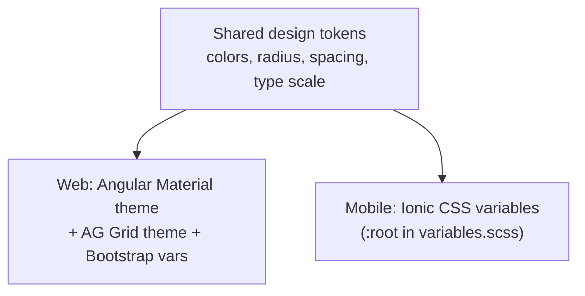

# UI Design System & Frontend Conventions
## Fleet Management System

| Field | Value |
|---|---|
| Document Title | Fleet Management System — UI Design System & Frontend Conventions |
| Version | 1.0 (Draft — complete) |
| Date | 2026-10-10 |
| Status | Draft — ready for review |
| Related | docs/business_requirement.md, docs/architecture_specification.md, docs/implementation_plan.md, docs/PROJECT-LOG.md |

> Purpose of this document: so every developer builds the **same look, same colors,
> same components, and same patterns** across all three apps — removing UI ambiguity.

---

## 1. Purpose & Scope

This document defines the shared visual language and frontend conventions for all
three applications so any developer produces a consistent result:
- **Super Admin Web App** — Angular + Angular Material + AG Grid + Bootstrap.
- **Admin Mobile App** — Ionic + Angular.
- **User Mobile App** — Ionic + Angular.

It covers colors, typography, spacing, components, UX patterns, and the frontend
architecture pattern. Colors and tokens are **shared values**; UI components are not
shared across the UI-kit boundary (see §13).

## 2. Design Principles

| Principle | Meaning |
|---|---|
| Friendly & rounded | Soft rounded corners, approachable spacing, clear labels. |
| Naval blue + white | Primary naval blue on a clean white canvas; light grey shadowed surfaces for dialogs/forms. |
| Clear feedback | Every action shows a state: loading, success (green), error (red). |
| Red means danger | Red is reserved for destructive actions (delete) and errors only — never for normal primary actions. |
| Consistent across apps | Same colors, typography, and patterns on web and mobile, even though the component kits differ. |
| Light mode only (v1) | No dark mode in the first release. |
| Mobile-first | Designed for small screens first; scales up for the web app. |

## 3. Color Palette (Design Tokens)

These hex values are the single source of truth. Use the **token name** in code, not
raw hex, wherever the stack allows.

| Token | Hex | Usage |
|---|---|---|
| `--color-primary` | `#1565C0` | Primary (naval) blue — headers, primary buttons, active states, links. |
| `--color-primary-contrast` | `#FFFFFF` | Text/icons on primary. |
| `--color-accent` | `#FFA000` | Amber — highlights, secondary/FAB actions, badges. |
| `--color-success` | `#2E7D32` | Green — success toasts/dialogs, approved status. |
| `--color-error` | `#D32F2F` | Red — errors AND destructive actions (delete/reject). |
| `--color-warning` | `#F9A825` | Amber-dark — warnings, expiring insurance/FC. |
| `--color-background` | `#FFFFFF` | App background (white). |
| `--color-surface` | `#F5F6F8` | Light grey surface for cards, dialogs, forms. |
| `--color-surface-shadow` | `rgba(0,0,0,0.12)` | Soft shadow for dialogs/forms/cards. |
| `--color-text-primary` | `#1A1A1A` | Primary text. |
| `--color-text-secondary` | `#5F6B7A` | Secondary/muted text. |
| `--color-border` | `#E0E3E7` | Dividers, input borders. |
| `--color-disabled` | `#B0B8C1` | Disabled text/controls. |

**Status colors** (trip workflow): Draft = grey `#5F6B7A`, Submitted = amber
`#FFA000`, Approved = green `#2E7D32`, Rejected = red `#D32F2F`.

> Accessibility: body text must meet WCAG AA contrast (≥ 4.5:1). Naval blue `#1565C0`
> and the greys above pass on white; never put grey secondary text on the grey surface
> without checking contrast.

## 4. Typography

**Font family:** Roboto (with system sans-serif fallback). Load once; same on all apps.

| Role | Size / Weight | Use |
|---|---|---|
| Display / Page title | 24px / 500 | Screen titles |
| Section heading | 20px / 500 | Card and section headers |
| Subheading | 16px / 500 | Group labels |
| Body | 14px / 400 | Default text, forms |
| Caption / Helper | 12px / 400 | Hints, validation helper text |
| Button | 14px / 500 (no ALL CAPS) | Buttons |

```scss
$font-family-base: 'Roboto', 'Helvetica Neue', Arial, sans-serif;
```
- Line height ~1.5 for body. Avoid all-caps buttons to keep the friendly tone.

## 5. Spacing, Radius & Elevation

**Spacing scale (8px base):** 4, 8, 12, 16, 24, 32px. Use multiples of 8 for layout.

**Corner radius (rounded / friendly):**
| Token | Value | Use |
|---|---|---|
| `--radius-sm` | 6px | Inputs, chips, small buttons |
| `--radius-md` | 10px | Buttons, cards |
| `--radius-lg` | 16px | Dialogs, sheets, large cards |
| `--radius-pill` | 999px | FAB, badges, toggles |

**Elevation (soft shadows on grey surfaces):**
| Level | Shadow | Use |
|---|---|---|
| 1 | `0 1px 3px rgba(0,0,0,0.12)` | Cards, list items |
| 2 | `0 4px 12px rgba(0,0,0,0.12)` | Dialogs, forms, menus |
| 3 | `0 8px 24px rgba(0,0,0,0.16)` | Modals, popovers |

## 6. Iconography, Logo & Imagery

| Item | Convention |
|---|---|
| Icons (web) | Angular Material Icons set. |
| Icons (mobile) | Ionicons (built into Ionic). |
| Icon style | Outline/rounded to match the friendly tone; single color (primary or text). |
| Logo | **Placeholder for now** — store at `docs/assets/logo.png` and app `assets/` folders; replace when the real logo is provided. Keep a white-background and a primary-blue variant. |
| Photos | Trip receipts, RC card, license — shown as thumbnails with tap-to-zoom; never full-bleed. |

## 7. Component Conventions

Same intent everywhere; the actual component comes from the app's own kit.

| Pattern | Web (Super Admin) | Mobile (Admin/User) |
|---|---|---|
| Buttons | `mat-button` / `mat-raised-button`; primary = naval blue filled, secondary = outline | `ion-button`; same color roles |
| Primary action | Filled naval blue | Filled naval blue |
| Destructive action | Red (`#D32F2F`), always behind a confirm dialog | Red, with confirm |
| Data tables / lists | **AG Grid Community** (paginated, server-side filter/sort) | `ion-list` / cards (mobile-friendly) |
| Forms & inputs | `mat-form-field` (outline appearance), grey surface | `ion-item` / `ion-input` |
| Dialogs / modals | `mat-dialog`, grey surface + elevation 2, radius-lg | `ion-modal` / `ion-alert` |
| Toasts / snackbars | `mat-snack-bar` (success green / error red) | `ion-toast` |
| Stepper (trip) | `mat-stepper` (Trip Info → Odometer → Expenses → Review) | `ion` stepped segments / multi-step form |
| Pagination | AG Grid paging / `mat-paginator` | infinite scroll or paged list |
| Status chips | `mat-chip` colored by trip status | `ion-chip` / `ion-badge` |

**Rules**
- Web uses Material + AG Grid + Bootstrap only; mobile uses Ionic only. Never import
  one kit into the other app (see §13).
- Buttons are not all-caps; use radius-md; primary actions are naval blue.

## 8. UX Patterns (states, feedback, destructive actions)

| Situation | Standard treatment |
|---|---|
| Loading | Vehicle-running loader (see §9); disable the triggering control. |
| Empty list | Friendly illustration + one line + a primary action (e.g. "Add Trip"). |
| Error | Red inline message or error dialog; never show raw stack traces. |
| Success | Green toast (e.g. "Trip approved"). |
| Form validation | Inline helper text under the field in red; disable submit until valid. |
| Destructive action | Confirm dialog ("Delete this vehicle?") with the red button on the right; cancel on the left. |
| Save / Submit | Primary naval-blue button; show inline spinner while in flight. |
| Permission denied | Hide actions the role can't use; backend still enforces (403). |

> Consistency rule: the same event always looks the same across all three apps
> (e.g. a successful save is always a green toast).

## 9. Loader & Animations

**Primary loader:** a small **vehicle-running animation** (e.g. a truck/car moving
left-to-right on a road line) used for page and action loading.

| Aspect | Convention |
|---|---|
| Format | Lightweight CSS/SVG animation (preferred) or a small Lottie JSON; keep file small for mobile. |
| Colors | Vehicle in naval blue `#1565C0` on white; motion line in grey. |
| Usage | Full-screen centered for page loads; inline small variant inside buttons/cards. |
| Duration feel | Smooth loop ~1s; respect `prefers-reduced-motion` (fall back to a simple spinner). |
| Shared asset | Store the animation in `frontend/shared/assets/` and reuse in all three apps (asset, not a component). |

Other motion: keep transitions subtle (150–200ms ease) for dialogs and page changes.

## 10. Responsive Layout & Breakpoints

| Breakpoint | Width | Target |
|---|---|---|
| xs | < 576px | Phones (mobile apps) |
| sm | ≥ 576px | Large phones |
| md | ≥ 768px | Tablets |
| lg | ≥ 992px | Small laptops (web app) |
| xl | ≥ 1200px | Desktops (web app primary) |

- Web app (Bootstrap 5 grid) is designed for `lg`/`xl`, usable down to `md`.
- Mobile apps target `xs`/`sm`; use Ionic responsive utilities.
- Tables: on web use AG Grid; on mobile never use wide tables — use stacked cards/lists.

## 11. Accessibility Baseline

| Area | Requirement |
|---|---|
| Contrast | Text ≥ WCAG AA (4.5:1); check grey-on-grey. |
| Touch targets | ≥ 44×44px on mobile. |
| Labels | Every input has a visible label; icons-only buttons have `aria-label`. |
| Focus | Visible focus ring (naval blue outline); logical tab order. |
| Motion | Honor `prefers-reduced-motion` (swap vehicle loader for a spinner). |
| Color independence | Never convey status by color alone — pair with text/icon (e.g. "Approved ✓"). |

## 12. Frontend Architecture Pattern

Same pattern in all three apps (confirmed), so code is predictable and testable.

**Structure (feature-based):**
```
src/app/
  core/          # singletons: auth, http interceptor, guards, config
  shared/        # reusable presentational components, pipes, directives
  features/
    trips/
      pages/          # smart/container components (routed, fetch data)
      components/      # presentational ("dumb") components (inputs/outputs only)
      services/        # feature API service
      models/          # view models (import shared DTOs)
    users/ ...
```

**Rules**
| Topic | Convention |
|---|---|
| Components | Angular **standalone** components (no NgModules). |
| Smart vs dumb | Container pages fetch data + hold state; presentational components take `@Input()`/`@Output()` only and contain no API calls. |
| State | **Angular Signals** for local/view state. No NgRx or other state lib. |
| Data access | Feature `*.service.ts` calls the shared API client; components never call HTTP directly. |
| Async | RxJS for streams; convert to Signals for templates where helpful. |
| Shared models | Import DTOs/clients from `frontend/shared/` — never redefine them per app. |
| Naming | `trip-list.page.ts`, `trip-card.component.ts`, `trip.service.ts`, `trip.model.ts`. |
| Testability | Logic lives in services/containers behind injectable seams so unit tests hit the 80% gate. |

## 13. Web vs Mobile Theming (UI-kit boundary)

**Hard boundary:** Angular Material + AG Grid + Bootstrap are for the **Super Admin
web app only**; Ionic components are for the **Admin and User mobile apps only**.
Never build a shared UI component library that mixes the two.

**What IS shared:** the **design tokens** (color hex values, radius, spacing,
typography scale) and the loader asset — as plain values/assets, applied separately
in each kit.



So both apps look identical in color and feel, while each uses its own native
components.

## 14. Theming Implementation (per stack)

Illustrative; the Developer agent wires the real theme files.

**Ionic (mobile) — `theme/variables.scss`**
```scss
:root {
  --ion-color-primary: #1565C0;
  --ion-color-primary-contrast: #FFFFFF;
  --ion-color-secondary: #FFA000;
  --ion-color-success: #2E7D32;
  --ion-color-danger: #D32F2F;
  --ion-color-warning: #F9A825;
  --ion-background-color: #FFFFFF;
  --app-surface: #F5F6F8;
}
```

**Angular Material (web) — theme (M3 tokens)**
```scss
// Define a light theme with primary = naval blue, tertiary/accent = amber.
// Map success/danger to custom CSS vars used by snackbars/badges.
:root {
  --color-primary: #1565C0;
  --color-accent:  #FFA000;
  --color-success: #2E7D32;
  --color-error:   #D32F2F;
  --color-surface: #F5F6F8;
}
```

**Bootstrap 5 (web) — SCSS overrides**
```scss
$primary: #1565C0;
$success: #2E7D32;
$danger:  #D32F2F;
$warning: #F9A825;
$border-radius: 10px;
@import 'bootstrap/scss/bootstrap';
```

**AG Grid (web):** use a Community theme and override its CSS vars to match
(`--ag-header-background-color`, selection/hover in naval blue, etc.).

## 15. Testing Considerations

| Layer | What to test |
|---|---|
| Presentational components | Render with given inputs; emit correct outputs; status → correct color/label. |
| Container pages | Loading/empty/error/success states; calls the right service. |
| Theme | Smoke test that primary/success/error tokens resolve (no missing CSS vars). |
| Accessibility | Labels present, focus order, reduced-motion fallback. |
| Tooling | Jasmine + Karma + karma-coverage (unit), Playwright (web E2E of key flows). |

Keep presentational components pure (inputs/outputs) so they are trivial to unit test
toward the 80% gate.

## 16. Design Tokens — Single Source of Truth

| Token | Value |
|---|---|
| Primary (naval blue) | `#1565C0` |
| Primary contrast | `#FFFFFF` |
| Accent (amber) | `#FFA000` |
| Success (green) | `#2E7D32` |
| Error / destructive (red) | `#D32F2F` |
| Warning | `#F9A825` |
| Background | `#FFFFFF` |
| Surface (grey) | `#F5F6F8` |
| Text primary | `#1A1A1A` |
| Text secondary | `#5F6B7A` |
| Border | `#E0E3E7` |
| Font | Roboto |
| Radius (md) | 10px |
| Spacing base | 8px |
| Theme mode | Light only (v1) |
| Loader | Vehicle-running animation (naval blue on white) |

**Open item:** real **logo** to replace the placeholder (user to provide).

