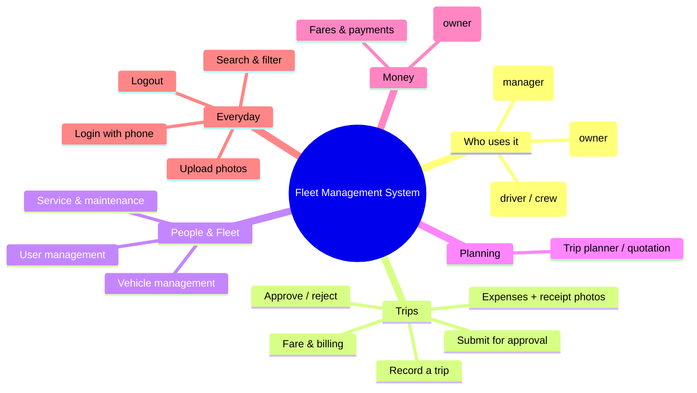
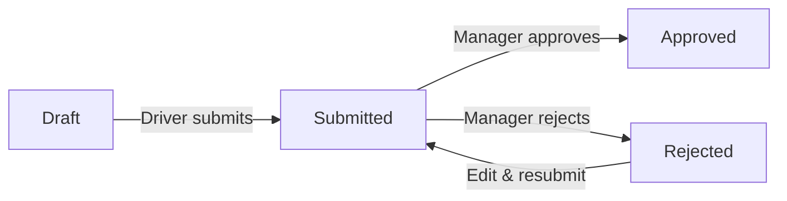

# User Manual
## Fleet Management System

| Field | Value |
|---|---|
| Version | 1.0 (Draft) |
| Date | 2026-10-10 |
| Audience | End users (business owner, managers, drivers/crew) |
| Related | docs/business_requirement.md |

> This guide explains how to use the Fleet Management System in simple steps. It is
> written for everyday users — no technical knowledge is needed.

---

## 1. What this app is for
The Fleet Management System replaces paper logbooks. It lets your company record
trips, fares, and expenses, manage drivers and vehicles, track vehicle service, plan
trips, and see expense and profit reports — all in one place.

The app comes in three versions:
- **Super Admin (web)** — for the business owner.
- **Admin (mobile)** — for managers.
- **User (mobile)** — for drivers, mechanics, and co-pilots.

You only use the version made for your role.

### 1.1 The app at a glance (mind map)

---

## 2. Who can do what (roles)

| Role | Who | What they can do |
|---|---|---|
| **Super Admin** | Business owner | Everything: trips, users, vehicles, services, trip planner, and expense/profit reports. Can also delete records. |
| **Admin** | Manager | Manage trips, users, vehicles, services, and trip planner, and approve trips. Cannot delete most records or see profit reports. |
| **User** | Driver / mechanic / co-pilot | Record and update **their own** trips, add fares and expenses, and add service entries. Cannot manage users or vehicles. |

### Quick permission summary
| Feature | Super Admin | Admin | User |
|---|---|---|---|
| Trips | Create, view, edit, delete | Create, view, edit | View & edit **own** trips |
| Approve / reject trips | Yes | Yes | No |
| Users | Create, view, edit, delete | Create, view, edit | No access |
| Vehicles | Create, view, edit, delete | Create, view, edit | No access |
| Service & Maintenance | Create, view, edit, delete | Create, view, edit | Create, view, edit |
| Trip Planner (Quotation) | Create, view, edit, delete | Create, view, edit | No access |
| Reports (Expense & Profit) | View | No | No |

---

## 3. Logging in
1. Open the app made for your role.
2. Enter your **phone number** and **password**.
3. Tap **Login**.

If the phone number or password is wrong, you'll see a message — check and try again.
If you forget your password, contact your administrator.

---

## 4. Finding your way around
After login you'll see a menu (side menu on web, tabs at the bottom on mobile) with
the features you're allowed to use. Tap a menu item to open that section.

Lists (like trips or vehicles) show a few records per page — use the page controls
or scroll to see more, and use the search/filter box to find a specific record.

---

## 5. Trips (the main feature)

A **Trip** is one journey from start to finish. It records the driver, vehicle,
distance, fare, and expenses.

### 5.1 Viewing trips
- **Drivers/Users:** you see only **your own** trips.
- **Admins/Super Admins:** you see **all** trips.
- Use filters (status, date, driver) to narrow the list.

### 5.2 Creating / recording a trip
Trips are created as a step-by-step form:

1. **Trip Info** — choose the driver and vehicle, enter the route/location and date.
2. **Odometer** — enter **Start KM** and **End KM**. The app calculates **Total KM**
   automatically. (End KM must be the same or higher than Start KM.)
3. **Fare / Billing** — enter the **Billed Amount** (fare). If GST applies, add the
   **GST amount** (optional — leave blank if not applicable). Enter any **Advance
   Paid**; the **Balance** is calculated automatically. Set the **Payment Status**
   (Unpaid, Partial, or Paid).
4. **Expenses** — add each cost: Fuel, Toll, Parking, Permit, and Other maintenance.
   You can attach a **photo of the receipt** for each. Add as many as needed.
5. **Review & Submit** — check the summary, then submit the trip for approval.

> Who can create: Super Admins and Admins create job sheets. Drivers record and
> update their own trips.

### 5.3 Trip status (what the labels mean)
| Status | Meaning |
|---|---|
| **Draft** | Being prepared; not yet sent for approval. |
| **Submitted** | Sent for a manager's approval. |
| **Approved** | A manager/owner approved it. |
| **Rejected** | A manager/owner sent it back; edit and resubmit. |

**How a trip moves along:**

### 5.4 Submitting for approval
When a trip is ready, open it and tap **Submit**. Its status changes to
**Submitted** and a manager can review it.

### 5.5 Approving or rejecting (Admin / Super Admin)
1. Open a **Submitted** trip.
2. Tap **Approve** to accept it, or **Reject** to send it back (you can add a reason).
Any admin or super admin can approve or reject — only one approval is needed.

### 5.6 About fare and profit
Everyone who can see a trip (including the driver) can see and enter the **fare**.
**Profit** (fare minus trip expenses) is **not shown to drivers** — only the business
owner sees profit in the reports.

---

## 6. User Management (Admin & Super Admin)
Manage the people in your company.

- **Add a user:** tap **Add**, then enter Name, Phone Number, Role, Designation,
  Aadhaar (optional), Date of Birth, License Number (required if the designation is
  **Driver**), and a Description. Tap **Save**.
- **Edit a user:** open a user, change the details, tap **Save**.
- **Delete a user:** only the Super Admin can delete.

> Aadhaar is kept private and shown masked (for example, XXXX XXXX 1234).

---

## 7. Vehicle Management (Admin & Super Admin)
Manage your fleet's vehicles.

- **Add a vehicle:** enter Vehicle Number, Insurance Till date and status, FC (Fitness
  Certificate) Till date and status, and upload the RC Card. Tap **Save**.
- **View service logs:** open a vehicle to see its service history.
- **Delete a vehicle:** only the Super Admin can delete.

---

## 8. Service & Maintenance
Record vehicle service and repairs. Available to all roles.

- **Add a service entry:** choose the vehicle, enter the Core Service, Spares, Service
  Cost, Other Maintenance Cost, Start Date, Estimated End Date, End Date, and a
  Description. Tap **Save**.
- **Delete a service entry:** only the Super Admin can delete.

---

## 9. Trip Planner / Quotation (Admin & Super Admin)
Plan a trip and estimate its cost before it happens.

- **Create a plan:** enter the Destination, choose Round Trip (Yes/No), Estimated KM,
  an optional **Estimated Fare**, and the planned From and To dates. **Total Days** is
  calculated automatically. Add any Trip Notes. Tap **Save**.
- This helps the owner plan requirements and budget before the journey.

---

## 10. Reports — Expense & Profit (Super Admin only)
The business owner can view:
- Total expenses for a period, broken down by Fuel, Toll, Parking, Permit, and Other.
- **Profit per trip** = Fare − trip expenses.

Choose a date range to see the figures.

---

## 11. Adding photos and documents
Wherever you see an upload or camera button (for example, trip receipts, RC Card, or
license), tap it to take a photo or choose a file. You can add more than one photo to
a trip. Tap a photo to view it larger.

---

## 12. Everyday tips
- **Search & filter:** use the search box and filters on list screens to find records
  fast.
- **Required fields:** if something is missing or wrong, the app highlights the field
  with a short message — fix it and continue.
- **Amounts** are shown in Indian Rupees (₹). **Dates** are shown as DD/MM/YYYY.

---

## 13. Logging out
Open the menu and tap **Logout**. For security, log out when you finish on a shared
device.

---

## 14. Common questions
**I can only see some trips — why?**
Drivers see only their own trips. Managers and the owner see all trips.

**I can't find Users or Vehicles.**
Those sections are for Admins and the Super Admin. Drivers don't have access.

**My trip was rejected.**
Open it, read the reason, make the changes, and submit again.

**I don't see profit numbers.**
Profit is visible only to the business owner (Super Admin) in Reports.

---

*For login or account help, contact your company administrator.*

